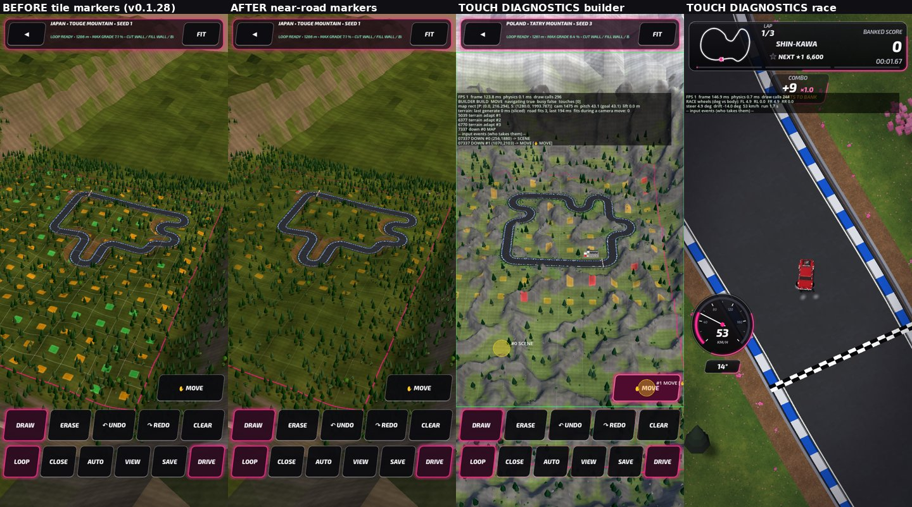

# Mobile QA — owner's phone test of v0.1.28, fixes in v0.1.32

**Tested build:** v0.1.28 = commit `add0883` on branch `ccr-91dad981-53kkbi`
([Android CI run](https://github.com/karllondor/Nitro-Wheelz-/actions/runs/44822723468/job/136587440675)). `main` still
reads 0.1.6 because nothing has been merged into `main` (that happens only when the owner asks); every test build
since v0.1.7 lives on this branch. All fixes below are on the same branch, on top of the Car Factory work (v0.1.29–31).

**Nothing here is marked fixed on the phone.** "Verified" means a code-level cause was found and an automated test
reproduces the old failure and passes now. Phone confirmation by the owner: NOT RUN.

## P0 — Track Builder touch and camera

| Finding (owner) | Cause found in the code | Fix | Automated check |
|---|---|---|---|
| MOVE + one finger: map moves unpredictably, sometimes against the finger | Every drag event re-ran the camera's mountain-occlusion search (about 2 000 terrain samples) and re-lifted the camera over the terrain under it. Both changed the camera **between two touch events**, so the ground point under the finger slid; over mountains it could flip the apparent direction. Near the horizon the pan also switched from the flat plane to the bumpy terrain hit. | While a finger (or two) moves the map the view pitch and camera lift are frozen; they ease once per frame and the occlusion search runs after the finger lifts. The pan always uses the plane at the grab height. | `builder_touch_test`: 24 drag steps in the Tatry, the ground point stays under the finger (0.000 m drift); pitch unchanged during the drag |
| Camera often ends up far from the track | A quick release "flung" the camera up to 0.44 x camera distance (hundreds of metres at overview zoom). | No fling; the view stops where the finger lifts; the view centre is clamped to the generated map. | same test: the map does not move after the finger lifts |
| Dead area at the bottom left | In BUILD the map rectangle was still the SETUP one (four button rows), so a strip about 15 % of the screen height above the two BUILD rows ignored touches — left of the MOVE button, i.e. bottom left. A second pinch finger landing there was ignored too, so pinches failed. | One map rectangle per stage; in BUILD the map reaches the button rows (the MOVE button takes its own touches). | same test: one finger draws there, MOVE pans there, two fingers there pinch; the touch-diagnostics hit test reports SCENE there and MOVE on the button |
| Map "freezes" after drawing | The small "UPDATING TERRAIN" pill had an invisible full-screen layer that swallowed every touch, and the builder dropped all touches while the terrain adapted. | The pill lets touches through; while the terrain adapts the map can be moved and zoomed; drawing and world-changing buttons (CLEAR, SAVE, DRIVE, ...) wait and say so; FIT / MOVE / VIEW work. | same test |
| (found by the new test) | A pinch whose first finger had not started a stroke left the stroke pointer set; lifting that finger ran a terrain fit. | The gesture always clears the stroke pointer; a lift ends only an active stroke. | same test: no terrain fit during camera moves |
| Diagnostics for touch IDs, hitboxes, input order | — | DEVELOPER > **TOUCH DIAGNOSTICS** (see docs/DEVELOPER_MODE.md): every touch with ID and the control that takes it, red hitboxes, green map area, event log, FPS / frame / physics ms, draw calls, builder stage / camera / road-fit counters (including fits during a camera move — must stay 0), race wheel angles. | manual on the phone |

Sensitivity values were not changed: the problems were in the event handling and the camera, not in speed factors.

### Terrain updates and performance
- Camera moves never start a terrain rebuild: road fits run only after a stroke ends / UNDO / REDO / CLEAR / AUTO,
  never from navigation (counted in the diagnostics, asserted by the test).
- The camera's occlusion search (the main per-move cost) no longer runs during a drag.
- Generation and road fits stay sliced (35 ms budget per frame) behind the loading card / pill; their last durations
  are shown in TOUCH DIAGNOSTICS on the phone. Desktop container reference: `terrain_world_test` generates 80 worlds
  (8 landscapes x 10 seeds) in 32–40 s, i.e. about 0.4–0.5 s per world headless. Phone timings: NOT RUN.

## P0 — Rear wheels steering on the first drift

Not reproduced. `wheel_visual_test` drives every car (procedural Lada RED / WHITE, RYU-32, E30 GLB and the Car Factory
test models) through a launch + handbrake drift right after the start and again after RESTART and measures every
wheel's visual angle against the body each physics step: rear wheels 0.00° on all seven models, front wheels equal the
physics steering angle, body yaw equals the physics heading, the first drift equals the drift after RESTART.

A plausible cause of what the phone showed: the top-down camera always started looking along -Z and swung round to the
car in the first moments of a run; on tracks starting in another direction (most builder tracks) the car briefly
appeared to drive "down" the screen, which makes the steered front wheels read as rear wheels. v0.1.32 places both
cameras behind / above the car's start heading at the start, after the terrain loads and after RESTART.
**Please check on the phone with TOUCH DIAGNOSTICS on:** the race lines show `FL / FR / RL / RR` angles live — if a rear
value ever leaves 0.0, a screenshot of that line tells us which wheel and when.

## P1 — World generation

| Finding | Cause | Change |
|---|---|---|
| "Large coloured rectangles placed regularly around the track", "a building grid instead of landscape" in Japan / mountains | The Track Builder's buildability markers: a green / amber / red square on **every** tile of the map in BUILD. | Markers are guidance near the road only: green just next to the open road ends, amber / red within 2 tiles of the road, faint red before the first tile; nothing elsewhere. Grid lines half as strong. The race never had them. |
| Scenery too close to the track | Low roadside planting started 0.9 m behind the verge. | 2.0 m (trees, rocks and buildings already keep the 6 m safety strip). |
| Objects crossing the road / barriers | Not reproduced: `terrain_scenery_test` (clearance, frontage gaps, roadside behind the barrier) and `procedural_world_test` (never on or near the race road) pass. | — |
| Sharp height transitions, odd road pieces while the terrain rebuilds | Not reproduced without the videos. While a fit runs, the preview road is drawn on the not-yet-deformed terrain for a moment. | Open — needs the clip timestamps. |

## P1 — HUD and progression

- **"CHASING 27,226" on different tracks — confirmed.** DRIVE from the Terrain Builder always saved the track under one
  id (`player_terrain_track`; the 3D tile builder used `player_built_track`), so every layout driven from the builder
  shared one record list and one best. Record ids now carry a fingerprint of the layout (geometry + landscape, not the
  name): the same layout keeps its records, a different layout starts with its own. Old pooled records stay under the
  old id and no longer show on new layouts. (`track_records_test`)
- **Next-star target:** the header pill now shows the next star of this track (`NEXT ★2  4,050`, same thresholds as
  the finish screen), then the personal best once all stars are earned, then `ALL STARS`.
- **Confirmation before RESTART / leaving a run:** the pause menu's RESTART and GARAGE / MENU need a second tap within
  2.5 s (the button says TAP AGAIN ...).
- Minimap readability: not changed in this build (open).

## Developer mode

Every option with range, default and effect: docs/DEVELOPER_MODE.md. New: TOUCH DIAGNOSTICS, RESET DEVELOPER
DEFAULTS, EXPORT DEVELOPER PRESET (file + clipboard). Developer settings moved to `user://nitro_dev.cfg`, apart from the
player's settings (migrated automatically). The proposed live handling sliders ("Nitro Dev Lab") are documented as a
proposal, not implemented.

## Generator vs Track Editor

Both editors already save the same Track DNA format and compile through `track_dna.gd` (the race validates both the
same way). Terrain tracks open in the Terrain Builder (the node editor has no landscape). A single editor with one
validation UI is a larger follow-up and was not started here.

## Evidence

Left to right: Track Builder markers before (green / amber squares on every tile) and after (only next to the road);
TOUCH DIAGNOSTICS in the builder (touch #0 in the former dead strip -> SCENE, the map pans; touch #1 -> the MOVE
button; red hitboxes, green map area, event log); TOUCH DIAGNOSTICS in a race (wheel angles: RL / RR 0.0).
Renders from the container (Xvfb, llvmpipe: the FPS numbers there are not phone numbers).

## Owner checklist for the phone (v0.1.32 APK)

1. Track Builder > DRAW ROAD > tap MOVE: drag with one finger in the mountains — the map follows the finger exactly; lift
   — it stops.
2. Two fingers starting just above the bottom buttons (left side): pinch and pan work.
3. Draw a road; while "UPDATING TERRAIN" shows, the map still pans.
4. DEVELOPER > TOUCH DIAGNOSTICS ON: tap the bottom-left area — the label must read SCENE; in a race watch RL / RR = 0.0
   during the first drift.
5. Drive two different builder tracks: the pill shows NEXT ★1 on each (no shared 27,226).
