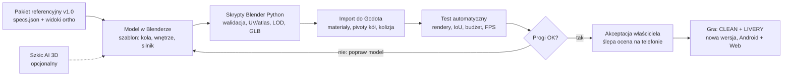

# Nitro Wheelz — Car Design & 3D Production Audit

2026-11-20 · kopia repozytoryjna dokumentu audytu (Claude Docs). Stan kodu: v0.1.23.

> **Aktualizacja v0.1.24:** właściciel zatwierdził do testów styl Premium Die-Cast + Nitro Rules i pipeline Blender + Python + GLB + Godot. Pierwszym autem testowym Car Factory zostało **E30 Blessed** zamiast RYU-32 — wyniki: [E30_BLESSED_PROTOTYPE.md](E30_BLESSED_PROTOTYPE.md).

## Wniosek w skrócie

Obecne auta są rozpoznawalne, ale obecna technika (karoseria liczona w GDScript z globalnych wzorów) nie dojdzie do jakości zatwierdzonych renderów. Rekomenduję hybrydową „Nitro Wheelz Car Factory”: karoseria modelowana ręcznie w Blenderze, automatyzacja w Pythonie, automatyczny import GLB do Godota i pomiarowa pętla render-vs-referencja. Styl: **B Premium Die-Cast Collectible** z własnymi regułami Nitro (E). AI 3D tylko jako szkic bryły, nie jako gotowy model.

**Ocena jakości obecnego RYU-32:** sylwetka z boku zgadza się z arkuszem w 74% (IoU), z góry w 92%, z tyłu tylko w 66%. Proporcje ogólne są bliskie, ale powierzchnie, detale i materiały są na poziomie prototypu, nie kolekcjonerskiego modelu.

**Trzy największe problemy:**

1. **Technika powierzchni.** Każdy przekrój karoserii to jedna superelipsa sterowana kilkoma globalnymi wykładnikami. Nie da się lokalnie postawić ostrej krawędzi, linii charakteru ani szczeliny panelu, więc bryła wygląda na „napompowaną”.
2. **Brak UV i tekstur.** Siatki aut nie mają współrzędnych UV. Livery, naklejki, numery, grille i lampy z tekstury są dziś technicznie niemożliwe; odbicia są udawane w shaderze.
3. **Dane wejściowe.** Dla RYU-32 jest jeden arkusz w stylu AI: widoki różnią się między sobą o ok. 5–10%, brak wymiarów, a opis silnika (rzędowy z ITB) przeczy wybranemu V8 1UZ-FE.

**Największy zysk najmniejszym kosztem:** pakiet referencyjny v1.0 (sekcja 5) i jeden eksperyment RYU-32 w Blenderze porównany liczbowo z obecnym modelem (sekcja 8). Bez tego każdy pipeline będzie zgadywał.

Oznaczenia w dokumencie: **\[KOD\]** = potwierdzone w kodzie lub pomiarem; **\[PROPOZYCJA\]** = moja rekomendacja; **\[HIPOTEZA\]** = do sprawdzenia benchmarkiem lub testem.

## 1. Current pipeline audit \[KOD\]

Każde auto jest liczone w GDScript przy starcie sceny z funkcji matematycznych, bez plików 3D, bez UV i bez tekstur. Wszystko w tej sekcji sprawdziłem w kodzie albo zmierzyłem (eksport GLB przez GLTFDocument i zliczenie powierzchni w Godot 4.7.2 headless).

### Pliki i role

| Plik | Linie | Rola |
| --- | --- | --- |
| `scripts/vehicles/mesh_kit.gd` | 227 | Wspólne narzędzia: `bucket()`/`commit()` (jedna powierzchnia na materiał), `grid()` (powierzchnia parametryczna), `superellipsoid()`, `lathe()` (bryła obrotowa), `box()`, `fan()`, `tri()` |
| `scripts/vehicles/coupe_lowpoly.gd` | 505 | RYU-32: `_build_shell`, `_build_front`, `_build_rear`, `_build_wing`, `_build_engine_bay`, `_build_wheel`, `_make_shadow` |
| `scripts/vehicles/lada_lowpoly.gd` | 594 | Lada: ta sama architektura + `_build_boot_lid`, `_build_closed_bonnet`, `_apply_style` (RED / PEARL) |
| `scripts/vehicles/car_catalog.gd` | — | Fabryka `make(variant)`, dane `info()`, `profile()`, `handling()`, `engine()`, wybór auta |
| `assets/shaders/diecast_paint.gdshader` | 42 | Jeden shader dla wszystkich materiałów auta |

### Jak powstaje każdy element (RYU-32)

| Element | Technika w kodzie |
| --- | --- |
| Karoseria dolna | `grid` 64×40: przekrój superelipsy (`SHELL_EXP 5.2`) przesuwany wzdłuż długości, zaokrąglenia `PLAN_ROUND 0.20`, `ELEV_ROUND 0.09`, wypukłość maski z `_deck()` |
| Kabina | osobny `grid` 56×44, łączony z karoserią gładkim minimum `_smin` |
| Szyby | wycinki tej samej powierzchni kabiny w materiale `glass`: nieprzezroczyste, ciemne, bez wnętrza |
| Nadkola | `_arch_point`: osobne pierścienie nakładane na karoserię („bolt-on”), czarne `well` w środku |
| Zderzaki, grill | końce bryły (`_end_inset`) + płaskie `box`/`fan` w materiale `trim` |
| Lampy | superelipsoidy i wachlarze z emisją (`glow` 1.0–1.4), bez soczewek i odbłyśników |
| Felgi | `lathe` 32 segmenty: opona, chromowany kołnierz, misa 0.11 m, 5 szprych-superelipsoid, nakrętka |
| Spoiler | `_build_wing`: płat na słupkach, 772 trójkąty |
| Silnik V8 | blok i głowice z superelipsoid, 8 trąbek `lathe` po 18 segmentów, kopuły amortyzatorów, rozpórki z `box` |
| Lusterka | superelipsoidy |
| Cień | `PlaneMesh` 2.8×5.8 m z shaderem rozmytej plamy, bez prawdziwego cienia |

### Jak budowana jest siatka

- `SurfaceTool`, trójkąty bez indeksów: liczba wierzchołków = 3 × liczba trójkątów.
- Normalne liczone ręcznie (`set_normal`) z różnic skończonych funkcji powierzchni; brak `set_uv` w całym katalogu `vehicles` — siatki aut nie mają UV.
- Jedna powierzchnia (draw call) na materiał w każdym `MeshInstance3D`; siatki trzymane w statycznym cache per wariant.
- Kontrola krzywizny jest globalna: jeden wykładnik i dwa zaokrąglenia sterują całą karoserią. Ostre krawędzie istnieją tylko na łączeniach osobnych elementów albo przez `hard_angle` w `lathe`.

### Materiały i światło

- 12 `ShaderMaterial` z jednego shadera: paint, glass, chrome, trim, rubber, rim, lamp, tail, amber, lens, engine, well (+ cień = 13).
- Shader używa prawdziwych świateł sceny (`diffuse_burley`, `specular_schlick_ggx`), ale odbicia są udawane: trzy „softboxy” i kopuła liczone z wektora odbicia w przestrzeni widoku i dodawane jako `EMISSION`. Odbicia nie zależą od otoczenia toru.
- Brak tekstur, map normalnych, reflection probe i map otoczenia.

### Zmierzone liczby

| Auto | Trójkąty | Wierzchołki | Draw calle | Materiały | GLB | Budowa |
| --- | --- | --- | --- | --- | --- | --- |
| RYU-32 (blue) | 36 400 | 109 198 | 33 | 13 | 3,9 MB | 86 ms |
| Lada (red) | 30 870 | 92 608 | 32 | 13 | 3,2 MB | 81 ms |
| Lada (white) | 28 470 | 85 408 | 29 | 11 | 3,1 MB | 73 ms |

Rozkład RYU-32: karoseria 22 738 trójkątów (9 draw calli), silnik 3 576 (5), spoiler 772 (2), cztery koła 9 312 (16), cień 2 (1). Koła to 25% trójkątów i prawie połowa draw calli: 4 instancje × 4 materiały. W rendererze Compatibility Godot nie łączy automatycznie identycznych siatek (instancing działa tylko w Forward+), więc każde koło płaci osobno.

### Co działa, a co nie

| Działa | Nie działa |
| --- | --- |
| Deterministyczne, zero plików binarnych w repo | Brak lokalnej kontroli krawędzi, linii charakteru, szczelin paneli |
| Proporcje zmieniane liczbami, łatwe A/B | Każda zmiana kształtu to zgadywanie wzoru, nie modelowanie |
| Spójny, jasny „zabawkowy” połysk na telefonie | Odbicia sztuczne, identyczne w każdym otoczeniu |
| Koła skręcają i obracają się | Brak UV: brak livery, naklejek, tekstur lamp i grilla |
| Sylwetka z góry trafiona (IoU 0,92) | Szyby nieprzezroczyste, brak wnętrza i klatki |
| Budowa < 0,1 s, mieści się w Web/Android | 3× więcej wierzchołków niż potrzeba (brak indeksów), brak LOD |

Granica jakości obecnej techniki: można dalej poprawiać proporcje i dokładać prymitywy, ale każdy detal karoserii wymaga nowej funkcji matematycznej. Koszt rośnie szybciej niż jakość, a przy 20–50 autach to 500–600 linii kodu na auto.

## 2. Visual quality problems

RYU-32 różni się od arkusza bardziej powierzchnią i detalem niż ogólną bryłą: sylwetka z góry pokrywa się w 92%, z boku w 74%, z tyłu tylko w 66% (IoU, pomiar).

### Jakie obrazy były użyte \[KOD\]

- RYU-32: jeden niebieski arkusz modelarski z czatu (widoki przód, tył, oba boki, góra, 3/4 z otwartą maską). Innych referencji RYU-32 nie dostałem.
- Lada: dwa arkusze białe, dwa czerwone i jeden obraz pomarańczowego widebody jako nastrój.
- `assets/references/approved/` jest pusty (tylko `.gitkeep`), a `assets/approved_assets.json` ma pustą listę. Żadna referencja nie jest formalnie zatwierdzona.

### Jak 2D trafiło do 3D

Stałe w kodzie (długość 4,545 m, rozstaw osi 2,615 m, szerokość 1,90 m, promień koła 0,36 m, dach 1,29 m itd.) zostały dobrane z proporcji arkusza i typowych danych tego typu auta, a potem strojone na oko przez porównywanie renderów. Do tego audytu nie było żadnego pomiaru liczbowego.

### Pomiar sylwetek

Metoda: rendery ortograficzne z Godota, wycięcie sylwetki z tła (odległość koloru od tła + nasycenie), największa spójna część, normalizacja do ramki, IoU i stosunek wysokości do szerokości/długości (H/L).

| Widok | IoU | H/L arkusz | H/L nasz | Główna przyczyna różnicy |
| --- | --- | --- | --- | --- |
| Tył | 0,66 | 0,548 | 0,694 | spoiler na wysokich słupkach, za mało masy nisko (dyfuzor, zderzak) |
| Bok lewy | 0,74 | 0,295 | 0,289 | trąbki nad maską, wysoki spoiler, za krótki i za niski tył, progi za wysoko |
| Bok prawy | 0,74 | 0,283 | 0,289 | j.w. |
| Przód | 0,79 | 0,681 | 0,694 | spoiler wystaje nad dach, dolna warga zderzaka za wysoko |
| Góra | 0,92 | 0,398 | 0,417 | nasz o ok. 5% szerszy względem długości |

Rys. 1 — arkusz | nasz render | nakładka (czerwony = tylko arkusz, niebieski = tylko nasz model).

_(Rysunek porównawczy zawiera arkusz referencyjny właściciela, dlatego nie jest publikowany w tym publicznym repozytorium; jest w dokumencie audytu.)_

### Co widać w porównaniu 3/4

- **Bryła „napompowana”:** okrągłe przekroje, wysokie ramiona, brak ostrej linii bocznej i krawędzi maski.
- **Nadkola:** wystające, nakładane „bąble” zamiast poszerzeń wyprowadzonych z karoserii.
- **Komora silnika:** w arkuszu silnik jest pod maską (otwartą tylko w 3/4); u nas trąbki stale wystają ponad linię maski i psują sylwetkę z boku.
- **Spoiler:** wysoki płat na słupkach zamiast niskiego skrzydła na klapie.
- **Szyby:** czarne i nieprzezroczyste; w arkuszu widać fotele i klatkę (X), co mocno buduje „drogi model”.
- **Koła:** w arkuszu wyraźnie większe względem nadwozia, z głęboką miską i krawędzią rantu; u nas płaska tarcza z cienkimi szprychami, bez profilu opony.
- **Lampy i grill:** u nas proste prostokąty z emisją; w arkuszu klosze z wnętrzem, cienki grill, wąskie kierunkowskazy.
- **Brak:** szczelin paneli, klamek w głębi, prawdziwych odbić otoczenia.

Rys. 2 — widok 3/4: arkusz (lewo) i obecny RYU-32 (prawo).

_(Rysunek porównawczy zawiera arkusz referencyjny właściciela, dlatego nie jest publikowany w tym publicznym repozytorium; jest w dokumencie audytu.)_

### Dlaczego modele różnią się od zatwierdzonych wizualizacji

1. **Technika:** wzory globalne nie odtworzą lokalnych krawędzi i paneli (sekcja 1).
2. **Niespójny arkusz:** widoki różnią się między sobą o ok. 5–10% (np. H/L boku lewego 0,295 vs prawego 0,283). Żadna bryła 3D nie pasuje idealnie do wszystkich widoków, więc IoU ma sufit poniżej 1,0.
3. **Brak wymiarów:** arkusz nie podaje liczb, które dałoby się sprawdzić.
4. **Sprzeczna specyfikacja:** tekst arkusza opisuje silnik rzędowy z ITB, a wybrany jest V8 1UZ-FE.
5. **Brak pętli pomiarowej:** zmiany oceniałem wzrokowo, bez liczby, która mówi, czy jest lepiej.

### Czego potrzebuję i co mogę zrobić

Potrzebuję pakietu z sekcji 5 (osobne widoki ortho + `specs.json`). Porównywanie renderów z referencją umiem już robić automatycznie; w Car Factory będzie to test uruchamiany po każdej zmianie modelu, z progiem akceptacji.

## 3. Proposed art direction \[PROPOZYCJA\]

Rekomenduję **B Premium Die-Cast Collectible** jako bazę, z własnymi regułami Nitro (E) dla stance, kół i palety. To jedyny styl, który jednocześnie wygląda drogo w garażu, czyta się z góry na telefonie i daje się powtarzać przez 20–50 aut. Oceny poniżej to moja ocena projektowa, nie pomiar.

### Porównanie stylów

| Kryterium | A Realistic Low Poly | B Premium Die-Cast | C Stylized Mid-Poly | D Arcade Motorsport | E Własny Nitro |
| --- | --- | --- | --- | --- | --- |
| Atrakcyjność | średnia | wysoka | wysoka | średnia | zależy od wykonania |
| Rozpoznawalność modelu auta | wysoka | wysoka | średnia (karykatura) | średnia | ryzyko „niczyje” |
| Czytelność na małym ekranie | średnia (płaskie odcienie) | wysoka (połysk, kontrast) | wysoka | wysoka | — |
| Czytelność z góry i z chase | średnia | wysoka | wysoka | wysoka | — |
| Detal tuningu (felgi, aero, livery) | niski | wysoki | średni | wysoki (livery) | — |
| Spójność przy 20–50 autach | wysoka | wysoka, jeśli są reguły | trudna | wysoka | trudna bez reguł |
| Wydajność Web/Android | najlżejszy | średni (PBR + atlas) | średni | średni | — |
| Trudność / czas na auto | najniższa | średnia–wysoka | wysoka (ręczna stylizacja) | średnia | najwyższa na start |

E samo w sobie nie jest stylem, tylko zbiorem reguł. Dlatego proponuję B jako język wizualny i E jako dokument zasad („Nitro Die-Cast Rules”), który trzyma 50 aut w jednej rodzinie.

### Zasady die-cast (punkty startowe do zatwierdzenia na RYU-32)

Liczby poniżej to propozycje do weryfikacji na pierwszym aucie, nie potwierdzone limity.

- **Proporcje:** karoseria zgodna z referencją ±3%. Przesadzamy tylko stance: rozstaw kół +3–5%, prześwit −10–20% względem seryjnego, nigdy nie powiększamy kabiny ani nie pompujemy paneli.
- **Koła:** średnica +5–8% względem realnej, opona widoczna z góry jako ciemny pas. Bok opony z prawdziwym profilem (zaokrąglenie barku, napis jako tekstura/decal).
- **Głębokość felgi:** trzy poziomy — rant, misa, szprychy + centrum. Dla aut „deep dish” misa ok. 15–20% średnicy felgi, żeby była widoczna z kamery chase.
- **Nadkola:** wyprowadzone z powierzchni karoserii (jedna gładka bryła). Nakładane poszerzenia tylko tam, gdzie auto naprawdę je ma, wtedy z widocznymi śrubami z tekstury.
- **Prześwit:** szczelina opona–nadkole 1–3 cm w skali 1:1, ciemna i wąska.
- **Lakier:** podstawowy kolor + metaliczność/roughness + warstwa clear-coat; odbicia z małej mapy otoczenia (cubemap/panorama) dobranej do nastroju toru, zamiast obecnych softboxów liczonych w shaderze.
- **Lampy:** zamodelowany kształt klosza, wnętrze z tekstury (odbłyśnik, LED-y), osobna maska emisji. Tylne lampy segmentowane.
- **Szyby:** cofnięte 1–2 cm względem ramy, z gumową lub chromowaną uszczelką, przyciemnione półprzezroczyste. Przez szybę widać uproszczone wnętrze — to znak rozpoznawczy die-castu.
- **Wnętrze i klatka:** fotele, kierownica, deska, klatka z rur o 6–8 bokach, jeden ciemny materiał z atlasu.
- **Krawędzie:** każda twarda krawędź ma mały bevel (1–3 cm w skali 1:1), żeby łapała błysk. Nic ostrego jak nóż, nic rozmytego jak balon.
- **Upraszczanie:** detal mniejszy niż ok. 2 px w widoku gry nie jest geometrią. Zostaje w LOD0 garażowym albo w teksturze/mapie normalnych.
- **Szczeliny paneli:** ciemne linie z tekstury lub mapy normalnych (maska, drzwi, klapa), nie z geometrii.
- **Materiały:** stała paleta ok. 8 typów: lakier (solid / metallic / pearl), chrom, satynowy metal, czarny plastik, guma, szkło, klosz, emisja.
- **Światło:** garaż = studio z obrotem modelu; wyścig = mapa otoczenia zgodna z torem.
- **Bez karykatury:** przesadzamy stance, koła i połysk, nigdy kształt nadwozia. Auto ma wyglądać jak drogi model 1:18, nie jak zabawka dla dzieci.

## 4. 3D production technique comparison \[PROPOZYCJA\]

Rekomenduję **D Hybrydę z Blenderem w centrum**: ręcznie modelowana karoseria, Python automatyzuje wszystko powtarzalne, AI 3D tylko jako szkic. Kod proceduralny w Godocie zostaje do montażu, kolorów i fizyki, ale przestaje budować karoserię. Wybór nie wynika z tego, czego już używamy: obecna technika (A) wypada najsłabiej w jakości i skali.

| Kryterium | A Proceduralny GDScript (obecny) | B Blender → GLB → Godot | C AI 3D → Blender → Godot | D Hybryda (rekomendacja) |
| --- | --- | --- | --- | --- |
| Wierność wobec referencji | niska–średnia (IoU boku 0,74) | wysoka | średnia: szybka bryła, słabe detale i symetria | wysoka |
| Kontrola geometrii | globalna, przez wzory | pełna, lokalna | niska do retopologii | pełna |
| Kontrola UV | brak UV \[KOD\] | pełna | auto-UV, zwykle nieużyteczne pod livery | pełna, wspólny układ UV |
| Automatyzacja | pełna, ale każde auto to nowy kod | eksport, LOD, walidacja przez Python | generacja tak, porządki ręcznie | Python + import Godota + test porównawczy |
| 20–50 aut | 500–600 linii kodu na auto | czas modelarza na auto | szybki start, długie sprzątanie | szablon + wspólne części |
| Retopologia | nie dotyczy | nie (modelujemy czysto) | prawie zawsze | tylko dla szkiców AI |
| Web/Android | lekkie pliki, ciężkie siatki (brak indeksów) | kontrola przez budżet i LOD | ryzyko ciężkich siatek | kontrola przez budżet i LOD |

### Narzędzia AI 3D (stan na listopad 2026, źródła na końcu)

- **Meshy:** tryb Smart Topology daje tylko trójkąty; quady wymagają osobnego Remesh. Tryb Low Poly wszedł z Meshy-6 w styczniu 2026, a dokumentacja API zapowiada wycofanie endpointu `lowpoly` 30 października 2026 — trzeba sprawdzić, co go zastąpiło.
- **Tripo:** model „Smart Mesh” z docelową liczbą polygonów, opcje quad mesh i podziału na części (segmentacja). Większość opisów pochodzi z recenzji, nie z dokumentacji Tripo.
- **Hunyuan3D 2.5 (Tencent, otwarty):** mocny w kształcie i ostrych krawędziach według autorów; topologia wymaga retopo w Blenderze.
- **TRELLIS.2 (Microsoft, otwarty):** tylko trójkąty, dobry do szkicu bryły, nie do produkcji.

Wniosek \[HIPOTEZA\]: żaden z tych generatorów nie daje dziś symetrycznej, czystej karoserii z UV pod livery. Dla aut z dokładnymi wymiarami czyste modelowanie z blueprintu może być szybsze niż retopologia wyniku AI. Sprawdzi to eksperyment RYU-32 (sekcja 8): 2 generatory, pomiar IoU i czasu sprzątania.

### Co może zautomatyzować Blender Python (bpy, tryb `blender -b -P` w CI)

1. Import widoków referencyjnych jako płaszczyzn w skali 1:1 z wymiarów z pakietu.
2. Walidacja: nazwy części, sloty materiałów, symetria, budżet trójkątów, pivoty kół, skala i osie.
3. Wspólny układ UV i atlas, wypalenie AO.
4. Generowanie LOD (Decimate + ręczne poprawki tam, gdzie trzeba).
5. Eksport GLB z jednym zestawem ustawień.
6. Render obrotu z kamer identycznych jak w arkuszu i automatyczne IoU sylwetki.

Po stronie Godota: skrypt post-import przypisuje wspólne materiały, pivoty kół i kolizję na podstawie nazw węzłów.

### Czy dalej budować auta w kodzie?

Karoserii nie. W kodzie zostaje: montaż (pivoty, skręt, obrót kół), parametry lakieru i livery, światła, cień, fizyka. Obecne proceduralne auta zostają jako zapas do czasu, aż nowa wersja przejdzie kryteria akceptacji.

## 5. Reference package standard — Car Asset Reference Package v1.0 \[PROPOZYCJA\]

Każde auto potrzebuje pakietu z **osobnymi plikami** dla każdego widoku ortograficznego i z liczbowymi wymiarami. Jeden zbiorczy arkusz (jak obecny RYU-32) jest dobry jako zatwierdzenie stylu, ale nie jako blueprint: widoki w nim różnią się między sobą o ok. 5–10%.

| Plik | Status | Wymagania |
| --- | --- | --- |
| `specs.json` | obowiązkowy | długość, szerokość (bez lusterek), wysokość, rozstaw osi, rozstaw kół przód/tył, średnica i szerokość opony, średnica felgi, prześwit, zwisy przedni/tylny, silnik, napęd |
| `side_left.png` | obowiązkowy | ortho, bez perspektywy, auto na środku, koła proste |
| `front.png`, `rear.png` | obowiązkowy | ortho, ta sama skala co bok |
| `top.png` | obowiązkowy | ortho z góry, bez lusterek przesłaniających obrys |
| `three_quarter_front.png` | obowiązkowy | docelowy „glamour” render, wzór dla oceny końcowej |
| `three_quarter_rear.png` | zalecany | spoiler, lampy, dyfuzor |
| `wheel_closeup.png` | obowiązkowy | felga z przodu i w przekroju (głębokość misy) |
| `lamps_front.png`, `lamps_rear.png` | zalecany | kształt kloszy i układ wnętrza lamp |
| `engine_bay.png` | obowiązkowy dla aut z otwieraną maską | widok z góry i 3/4, zgodny z wybranym silnikiem |
| `interior.png` | zalecany | fotele, klatka, kierownica — to, co widać przez szybę |
| `livery_*.png` | opcjonalny | każda livery w widoku boku i góry |
| `palette.json` | obowiązkowy | kolory lakieru (hex), typ (solid/metallic/pearl), kolory felg i detali |

### Reguły techniczne

- **Rozdzielczość:** min. 2048 px po dłuższym boku auta dla widoków ortho, 4096 px zalecane. PNG bez kompresji stratnej.
- **Tło:** jednolite, kontrastowe do lakieru (np. jasnoszare dla ciemnego auta), bez cienia pod autem w widokach ortho — cień psuje automatyczne wycinanie sylwetki.
- **Spójność:** wszystkie widoki ortho w tej samej skali px/m, z zaznaczoną linią gruntu i osiami kół.
- **Źródło prawdy:** przy konflikcie wygrywa `specs.json`, potem bok, potem góra. Tekst na obrazkach nie jest specyfikacją.
- **Zatwierdzenie:** pakiet trafia do `assets/references/approved/<auto>/` dopiero po Twojej akceptacji i wtedy jest niezmienny (zgodnie z AGENTS.md).

### Czy da się analizować zdjęcia i porównywać rendery?

Tak, i już to zrobiłem dla RYU-32 (sekcja 2): wycinam sylwetkę z referencji i z renderu, normalizuję do ramki i liczę IoU oraz stosunki wymiarów. Przy pakiecie z wymiarami można mierzyć też błąd w metrach, a nie tylko kształt. Ograniczenie: z jednego zdjęcia perspektywicznego nie odczytam wiarygodnie głębokości (np. wysunięcia felgi) — do tego potrzebne są widoki ortho i liczby.

## 6. Recommended car factory pipeline \[PROPOZYCJA\]

Każde auto przechodzi ten sam łańcuch: pakiet referencyjny, model w Blenderze na wspólnym szablonie, skrypty Pythona, automatyczny import do Godota, pomiarowa bramka i Twoja akceptacja. Nic nie trafia do gry bez liczb.

Model, który nie przechodzi progów (IoU, wymiary, budżet), wraca do Blendera; szkic AI jest tylko jednym z możliwych wejść do modelu.

### Wspólny szablon auta (struktura GLB)

- `body` — karoseria: materiał lakieru + atlas detali.
- `glass`, `interior` — przyciemnione szyby i uproszczone wnętrze z klatką.
- `lights_front`, `lights_rear` — klosze z maską emisji.
- `bonnet` — osobna maska z pivotem na zawiasie.
- `engine_lod0`, `engine_lod1` — silnik garażowy i uproszczony.
- `wheel_FL/FR/RL/RR` — puste pivoty; jedna wspólna siatka koła z biblioteki.
- `mount_wing`, `mount_lip`, `mount_skirt` — punkty mocowania części tuningowych.
- `collision` — prosty prostopadłościan zgodny z `info()` w katalogu.

Kod w Godocie czyta te nazwy i składa auto: skręt i obrót kół, cień, światła, parametry lakieru. Fizyka i dźwięk zostają w obecnych profilach.

### CLEAN i LIVERY na jednym modelu

Obecnie niemożliwe, bo siatki nie mają UV \[KOD\]. Propozycja:

- **UV0** — wspólny atlas detali (grill, lampy, szczeliny paneli, śruby, AO), używany przez wszystkie auta.
- **UV1** — rozwinięcie paneli lakieru bez nakładań (boki, dach, maska, klapa, zderzaki) jako „szablon livery”.
- **Shader warstwowy:** kolor lakieru (parametr) → tekstura livery RGBA na UV1 (alfa = gdzie jest livery) → maska szczelin i AO z UV0 → clear-coat.
- **CLEAN** = brak tekstury livery. **LIVERY** = podmiana tekstury i parametrów na tej samej siatce i tym samym materiale.
- **Tworzenie livery:** Blender eksportuje PNG z obrysem UV1, livery malujesz w dowolnym programie graficznym, plik trafia do folderu auta.
- **Koła:** osobna biblioteka felg i opon z tym samym pivotem; średnica, szerokość i offset ze `specs.json`, więc każda felga pasuje do każdego auta.
- **Spoilery i bodykity:** części na punktach `mount_*`. Widebody zmieniający nadkola to wariant karoserii (`body_stock` / `body_wide`) z możliwie tym samym UV1.

### Maska i silnik 1UZ-FE V8 z ITB

- **Rozpoznawalność bez marek:** dwa rzędy cylindrów w V, 8 trąbek ITB w dolinie, dwie pokrywy rozrządu na każdym rzędzie, osłona paska z przodu, alternator, chłodnica, rozpórka kopuł. Bez logo producenta.
- **Osobna siatka:** `bonnet` otwiera się w garażu (animacja na zawiasie); silnik jest osobnym węzłem.
- **Garaż (LOD0):** pełny silnik na atlasie detali \[HIPOTEZA budżetu: 5–10 tys. trójkątów\].
- **Wyścig (LOD1):** uproszczony silnik \[HIPOTEZA: 0,5–1,5 tys. trójkątów\] albo całkiem ukryty przy zamkniętej masce.
- **Przełączanie:** jawnie (garaż / wyścig) zamiast polegać na automatycznym LOD, dopóki nie sprawdzimy, czy działa w Compatibility.
- **Decyzja dla Ciebie:** w arkuszu RYU-32 maska jest zamknięta z boku, a otwarta tylko w 3/4. Czy w wyścigu RYU-32 ma jeździć z maską, czy bez?

### LOD

LOD0 (garaż), LOD1 (wyścig), LOD2 (daleko, przyszłe auta AI) generowane w Blenderze i nazywane `_lod0/_lod1/_lod2`. W Godocie: jawne przełączanie garaż/wyścig oraz visibility ranges dla odległości; automatyczny LOD z importu dopiero po pomiarze w Compatibility.

## 7. Performance budget

Obecny RYU-32 ma 36 400 trójkątów i 33 draw calle na jedno auto \[KOD\]. Kolumna „cel” to moje wstępne cele \[HIPOTEZA\], nie potwierdzone limity: potwierdzi je dopiero pomiar na Twoim telefonie i w przeglądarce.

| Pozycja | Teraz \[KOD\] | Wstępny cel \[HIPOTEZA\] | Jak potwierdzić |
| --- | --- | --- | --- |
| Trójkąty, auto w wyścigu (LOD0) | 36 400 | 12 000–20 000 | FPS i czas klatki GPU na telefonie |
| Trójkąty, auto w garażu | 36 400 (ta sama siatka) | 40 000–80 000 (jedno auto na ekranie) | czas klatki w garażu |
| LOD1 (daleko, przyszłe auta AI/duchy) | brak LOD | 4 000–8 000 | test z 6 autami |
| LOD2 (miniatury, bardzo daleko) | brak | 1 000–2 000 | — |
| Draw calle na auto | 33 (koła: 16) | 6–10 | licznik draw calli w monitorze Godota |
| Materiały na auto | 13 | 4–6 (lakier, atlas detali, szkło, emisja, opona/felga) | — |
| Tekstury, wyścig | 0 | atlas 1024² + livery 512–1024² | pamięć GPU, czas ładowania Web |
| Tekstury, garaż | 0 | do 2048² | j.w. |
| Wierzchołki | 109 198 (bez indeksów = 3× trójkąty) | ok. 0,6–1× trójkąty (indeksowane) | eksport GLB |
| Rozmiar GLB na auto | 3,1–3,9 MB (eksport audytowy; dziś auta nie są plikami) | 1–3 MB z teksturami | rozmiar `.pck` Web |
| Czas przygotowania auta | 73–86 ms budowy w kodzie | < 100 ms wczytania GLB | pomiar na telefonie |

### Co wymaga benchmarku, zanim zamkniemy liczby

- **Telefon referencyjny:** potrzebuję modelu Twojego telefonu (albo innego średniaka) jako punktu odniesienia; dziś nie mam pomiarów FPS z urządzenia, tylko z CPU w kontenerze.
- **Automatyczny mesh LOD w Compatibility:** dokumentacja Godota 4.7 mówi, że LOD jest generowany przy imporcie glTF, ale nie mówi, czy działa w rendererze Compatibility. Trzeba to zmierzyć; zapasem są ręczne LOD przez visibility ranges.
- **Instancing:** w Compatibility nie ma automatycznego instancingu (dokumentacja: tylko Forward+), więc każde koło i każde auto to osobne draw calle. Wspólny materiał dla 4 kół + mniej slotów daje tu najwięcej.
- **Przezroczyste szyby:** koszt sortowania i overdraw na telefonie.
- **Kompresja tekstur:** ETC2/ASTC (Android) i S3TC/BPTC (desktop/Web) — wpływ na rozmiar Web i jakość livery.

Kontekst: dziś na torze jest jedno auto, a świat z Phase A ma ok. 78 tys. wierzchołków. Budżet jednego auta nie jest dziś wąskim gardłem, ale stanie się nim przy kilku autach na torze.

## 8. RYU-32 proof of concept plan \[PROPOZYCJA\]

Cel: wybrać pipeline na jednym aucie na podstawie liczb i ślepej oceny, zanim powstanie kolejne auto. Fizyka, wymiary kolizji (`info()` length/width) i dźwięk zostają bez zmian; nowe auto musi trzymać obecne wymiary RYU-32 (4,545 m długości, 2,615 m rozstawu osi) albo zmiana profilu będzie osobną decyzją.

### Warianty do porównania

| Wariant | Kto / jak | Limit czasu |
| --- | --- | --- |
| A Baseline | obecny proceduralny RYU-32, bez zmian | — |
| B1 Blender, skrypt | ja: klatka subdivision z creasami i bevelami budowana przez bpy, dopasowana do widoków ortho, UV + atlas | do ustalenia |
| B2 Blender, ręcznie | artysta 3D z pakietu referencyjnego (opcjonalnie, jeśli zdecydujesz się kogoś zatrudnić) | do ustalenia |
| C AI 3D | 2 generatory (np. Tripo + Hunyuan3D lub Meshy) z arkusza, potem sprzątanie w Blenderze | sztywny limit, np. 1 dzień pracy |

Ważne zastrzeżenie: nie modeluję ręcznie myszką. Wariant B1 to nadal model budowany skryptem, ale narzędziami Blendera (subdivision, crease, bevel, weighted normals, UV), które dają lokalną kontrolę krawędzi, jakiej brakuje obecnemu kodowi. PoC pokaże, czy to wystarcza, czy potrzebny jest artysta.

### Kroki

1. Zatwierdzenie pakietu referencyjnego RYU-32 v1.0 (sekcja 5) albo co najmniej `specs.json` + osobne widoki ortho.
2. Jeden automatyczny import do Godota i jeden zestaw kamer dla wszystkich wariantów (te same 5 widoków ortho + 3/4 + kamera z gry z góry i chase).
3. Pomiar metryk poniżej, tabela porównawcza, zrzuty z garażu i z jazdy.
4. Ślepa ocena: pokazuję Ci warianty jako X/Y/Z bez nazw, Ty oceniasz 1–10 na zrzutach z telefonu.
5. Decyzja o pipeline i dopiero wtedy wdrożenie do gry pod nowym numerem wersji.

### Metryki i wstępne progi akceptacji \[HIPOTEZA\]

| Metryka | Teraz (A) | Próg dla nowego wariantu |
| --- | --- | --- |
| IoU sylwetki: bok | 0,74 | ≥ 0,90 |
| IoU sylwetki: przód | 0,79 | ≥ 0,90 |
| IoU sylwetki: tył | 0,66 | ≥ 0,90 |
| IoU sylwetki: góra | 0,92 | ≥ 0,95 |
| Błąd wymiarów (dł., szer., wys., rozstaw osi) | nieznany (brak wymiarów w referencji) | ≤ 2% wobec `specs.json` |
| Trójkąty / draw calle / materiały | 36 400 / 33 / 13 | w budżecie z sekcji 7 |
| UV i livery | brak | CLEAN + 1 LIVERY na tej samej siatce |
| FPS na telefonie referencyjnym | niezmierzone | nie gorzej niż A |
| Czas produkcji | — | zapisany w godzinach dla każdego wariantu |
| Ocena wizualna (ślepa) | — | wyższa niż A i ≥ 8/10 |

Progi IoU są ograniczone niespójnością obecnego arkusza: przy widokach różniących się o 5–10% IoU 0,95+ może być nieosiągalne. Przy nowym pakiecie ortho progi można podnieść.

### Co dostarczę po PoC

- Dokument z tabelą metryk, nakładkami sylwetek i zrzutami garaż/wyścig dla każdego wariantu.
- Pliki `.blend` i `.glb` wariantów B/C oraz skrypty fabryki (walidacja, eksport, LOD, porównanie).
- Build testowy z przełącznikiem wariantu RYU-32 w garażu (Android + Web), pod nowym numerem wersji.

## 9. Rekomendacja i plan — odpowiedzi na pytanie 10 briefu

| Pytanie | Odpowiedź |
| --- | --- |
| Ocena obecnej jakości | Prototyp na poziomie „czytelna zabawka”. Proporcje bliskie (IoU góra 0,92, bok 0,74), powierzchnie, detale i materiały daleko od zatwierdzonych renderów. |
| 3 największe problemy | Globalna kontrola powierzchni bez krawędzi; brak UV i tekstur; niespójne dane wejściowe bez wymiarów (szczegóły na początku dokumentu). |
| Największy zysk, najmniejszy koszt | Pakiet referencyjny v1.0 dla RYU-32 + jeden eksperyment PoC z pomiarem. |
| Czy obecny kod osiągnie zatwierdzone rendery? | Proporcje prawdopodobnie tak (strojenie stałych). Jakości powierzchni, lamp, szczelin i livery — nie w rozsądnym czasie: wymagałoby to napisania własnego modelera z UV, czyli odtworzenia Blendera w GDScript \[opinia\]. |
| Czy zmienić pipeline? | Tak: D Hybryda z Blenderem w centrum (sekcja 4), po potwierdzeniu w PoC. |
| Docelowa „Nitro Wheelz Car Factory” | Diagram i opis w sekcji 6. |
| Pliki i referencje do dostarczenia | Pakiet z sekcji 5, decyzja silnik (1UZ-FE V8 — arkusz mówi „inline”), lista livery dla RYU-32, model Twojego telefonu do benchmarku. |
| Narzędzia | Blender (wersja LTS do ustalenia i zapisania), Python/bpy, Godot 4.7.2, numpy/PIL/scipy do porównań; opcjonalnie konta Tripo/Meshy (Twoje konta lub klucze API) do wariantu C. Do sprawdzenia: czy Blender da się zainstalować w tym środowisku chmurowym. |
| Co zautomatyzować | Import referencji w skali, walidacja, UV/atlas, LOD, eksport GLB, post-import w Godocie, rendery obrotowe, IoU i raport — lista w sekcji 4. |
| Pierwszy eksperyment | PoC RYU-32: warianty A / B1 / (B2) / C, te same kamery i metryki, ślepa ocena (sekcja 8). |

Następny krok po Twojej stronie: zatwierdzić kierunek stylu (B + zasady Nitro), zatwierdzić pipeline do testów (D) i dostarczyć albo zaakceptować pakiet referencyjny RYU-32. Do tego czasu niczego nie przebudowuję.

## Źródła

Dane o autach: kod w gałęzi `ccr-91dad981-53kkbi` (stan v0.1.23) i pomiary z Godot 4.7.2 headless. Strony zewnętrzne (stan na 20.11.2026; opisy narzędzi AI częściowo z recenzji, nie z dokumentacji producentów):

- [Godot 4.7 — Mesh level of detail (LOD)](https://docs.godotengine.org/en/4.7/tutorials/3d/mesh_lod.html)
- [Godot 4.7 — Visibility ranges](https://docs.godotengine.org/en/4.7/tutorials/3d/visibility_ranges.html)
- [Godot 4.7 — Optimizing 3D performance](https://docs.godotengine.org/en/4.7/tutorials/performance/optimizing_3d_performance.html)
- [Meshy API — Models](https://docs.meshy.ai/en/api/models) i [Meshy API — Remesh](https://docs.meshy.ai/en/api/remesh)
- [Meshy — Remesh guide](https://docs.meshy.ai/en/webapp/guides/3d-model/remesh)
- [Scenario — Tripo Family: The Complete Guide](https://help.scenario.com/articles/4692888910-tripo-family-the-complete-guide)
- [Tripo AI Review (2026)](https://pasqualepillitteri.it/en/news/7811/tripo-ai-review-3d-model-generator)
- [Hunyuan3D 2.5 — paper (arXiv 2506.16504)](https://web3.arxiv.org/pdf/2506.16504)
- [Scenario — Comparing Generative 3D Models](https://help.scenario.com/en/articles/comparing-generative-3d-models/)
- [3D AI Studio — Trellis 2 vs Hunyuan 3D](https://www.3daistudio.com/blog/trellis-2-vs-hunyuan-3d-differences-explained)
