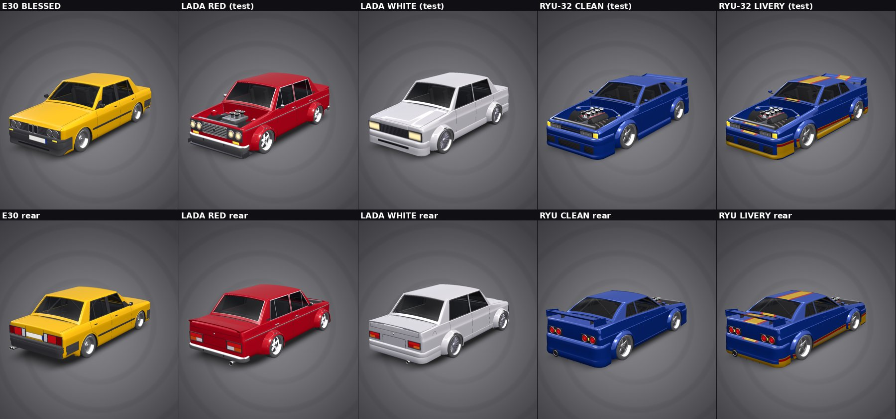

# Car Factory migration — stage 4 integration QA (v0.1.31)

Owner brief section 11, stage 4. Status of the whole collection after the migration. **Nothing here is approved until
the owner reviews it on the phone.**

| Car | Model in the default build | Factory model | Commit | Report |
|---|---|---|---|---|
| E30 Blessed | factory GLB (v0.3) | same | 11a9522 | E30_VISUAL_POLISH_v0.3.md |
| Lada 2106 RED / WHITE | procedural (approved) | TEST: one GLB, geometry variants | a9a2947 | LADA_2106_FACTORY.md |
| RYU-32 CLEAN / LIVERY | procedural (approved) | TEST: one GLB, paint-material looks (LIVERY provisional) | 9419cd7 | RYU32_FACTORY.md |

How to review on the phone: main menu > DEVELOPER > **CAR FACTORY TEST MODELS: ON**, then GARAGE (the status line says
FACTORY TEST MODEL) and DRIVE. **RYU-32 TEST LOOK** switches CLEAN / LIVERY. Switching the test models OFF restores
the approved procedural cars at once. Handling, sound, scoring, collisions, controls and saves are identical either way.

## Integration checks

| Check | Result |
|---|---|
| Full suite `tools/run_godot_checks.sh` (import + 31 tests) | see QA_MATRIX (stage 4 row) |
| `factory_models_test`: switch off/on, one GLB per car, variants / looks, budget, footprint, wheelbase, handling + engine profiles identical, garage = race | PASS (local) |
| `e30_factory_car_test` (budget, garage framing, cosmetics) after the paint-shader livery change | PASS (local) |
| `car_profiles_test` (Lada baseline bit-identical, RYU-32 V8) | PASS (local) |
| Each car keeps its own silhouette (lineup above) | visual check DONE |
| Budgets: E30 41 502, Lada RED 37 510 / WHITE 31 444, RYU-32 38 550 triangles; 8 draw calls each | PASS |
| CI (Android APK, Web, desktop, Godot) | a9a2947: all green; 9419cd7 + stage 4: see QA_MATRIX |
| Phone: look, frame time, owner acceptance | NOT RUN |

## Standard documents (stage 4 deliverable)

- CAR_FACTORY_STANDARD.md — rules, pipeline, GLB conventions, budgets, body techniques, integration, versioning.
- CAR_REFERENCE_PACKAGE_STANDARD.md — what to send, storage / licences, confidence levels, measuring.
- CAR_MATERIALS_AND_PAINT.md — three runtime materials, append-only atlas, paint shader parameters, livery layout.
- CAR_WHEEL_LIBRARY.md — wheel conventions, five designs, building blocks, checks.
- CAR_QUALITY_CHECKLIST.md — checklist with the solutions used, lessons learned.

## Open items for the owner

1. Visual acceptance of the Lada RED / WHITE and RYU-32 test models (and the E30 v0.3).
2. The RYU-32 LIVERY render (the current livery is provisional).
3. Optional: real photos of the RYU-32 build and the Lada for detail passes.
4. Decision per car: make the factory model the default (a one-line change of the switch default per car) once accepted.
