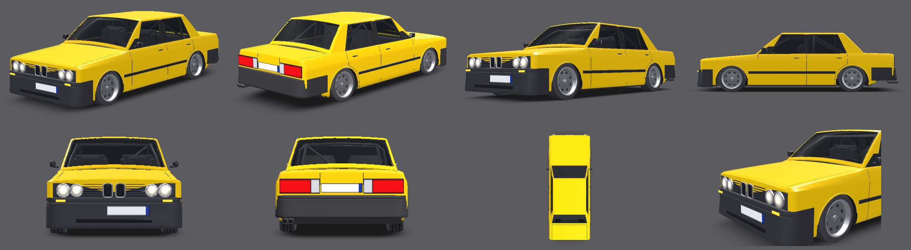
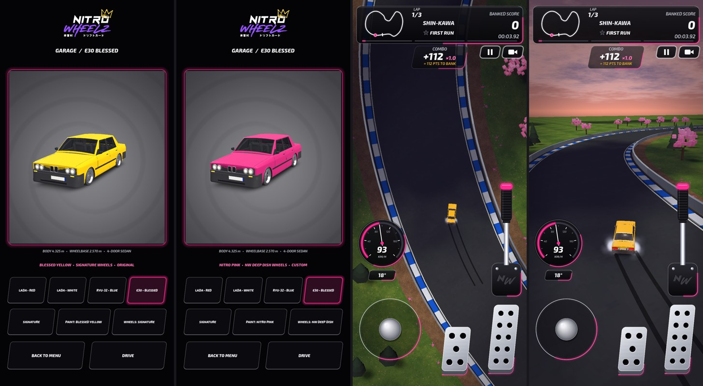
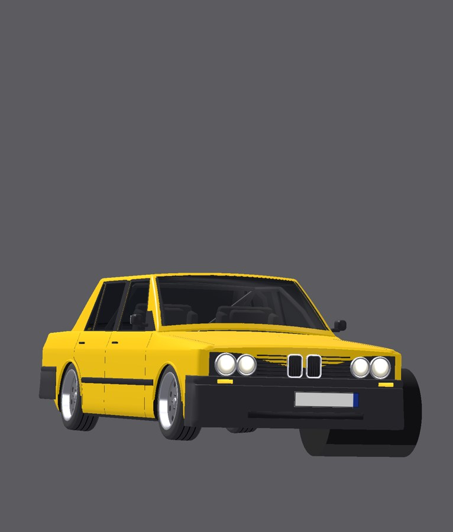
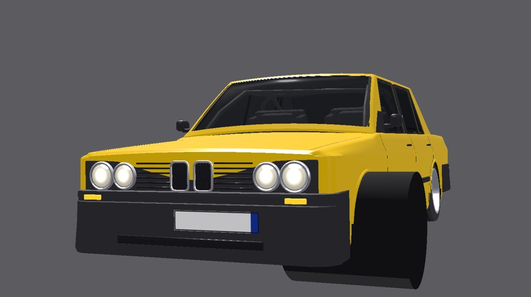
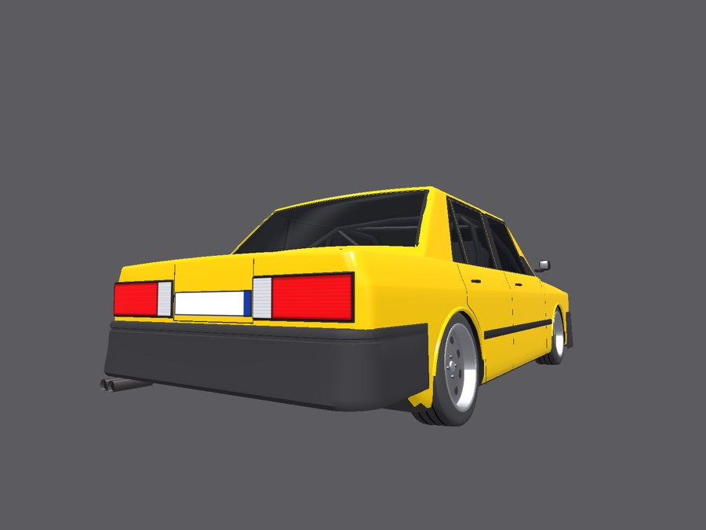

# E30 Blessed — pierwszy prototyp Nitro Wheelz Car Factory (v0.1.24)

2026-11-20 · gałąź `ccr-91dad981-53kkbi` · Godot 4.7.2 (GL Compatibility) · Blender `bpy 5.3.0`

**Wynik:** czterodrzwiowe E30 w Blessed Yellow zbudowane skryptem Blender Python, wyeksportowane do GLB i wpięte do gry jako czwarte auto. Ten sam model jest w garażu i na torze. Auto kosztuje **8 draw calli** (Lada 32, RYU-32 33) i mieści się w fabrycznych wymiarach z dokładnością do 6 mm. Sylwetka pokrywa się z trzema zdjęciami przy błędzie reprojekcji **2,4–2,6%** rozpiętości punktów kontrolnych. Garaż ma prototyp SIGNATURE / PAINT / WHEELS (tylko wygląd). Handling to kopia bazowej Lady z jedyną zmianą: potwierdzony rozstaw osi. Dźwięk to syntezowane R6 M52B28. Istniejące auta i ich fizyka są bez zmian.

## 1. Pakiet referencyjny: co potwierdzone, co nie

Źródło: `assets/references/drafts/e30_blessed_v0.1/` (README i JSON bez zmian, manifest zdjęć z sha256). **Zdjęć nie ma w repozytorium**, bo repo jest publiczne, a to zdjęcia osób trzecich (szczegóły w README pakietu).

| Informacja | Status | Użycie w prototypie |
|---|---|---|
| Czterodrzwiowe E30, żółty lakier, czarne zderzaki i listwa boczna | potwierdzone zdjęciami | model |
| Silnik M52B28 2.8 R6, wolnossący | potwierdzone przez twórcę (SRC01, SRC02) | profil dźwięku R6 |
| Długość 4,325 / szerokość 1,645 / wysokość 1,380 / rozstaw osi 2,570 m | fabryczne dane E30 (SRC06), nie pomiar tego auta | wymiary modelu i kolizji |
| 193 PS / 280 Nm | fabryczne M52B28 (SRC07), nie hamownia | tylko opis (`spec`) |
| Prześwit ~6,5 cm niżej, schowane opony, negatywny camber, średnica koła ~0,58 m | szacunek ze zdjęć | model (wizualnie) |
| Zwis przedni 0,765 m | proporcja z ilustracji przeniesiona na wymiary fabryczne | model |
| Felgi Colin Star Shark 4H, gwint BC Racing | **niepotwierdzone** (podpis osoby trzeciej, SRC08) | nieużyte |
| Zderzaki M3 / M-Tech II | **niepotwierdzone** (forum, SRC09) | nieużyte |
| Kąt skrętu, dyferencjał, przełożenia, masa, opony, moc z hamowni | **nieznane** | nie zgadywane (patrz sekcja 6) |
| Ilustracja boczna | stylizowana | tylko położenie słupków i szyb jako ułamki rozstawu osi |

## 2. Co widać na zdjęciach

- **Przód:** cztery okrągłe lampy w czarnym, poziomo żebrowanym panelu, nerki z chromowaną ramką, wysunięta „rekinia” krawędź maski, żółty pasek pod panelem, wysoki czarny zderzak z kierunkowskazami na rogach. Maska jest **założona** na wszystkich zdjęciach, więc model ma ją zamkniętą i nie ma silnika (zgodnie z zasadą „jeśli oryginał ma odsłonięty silnik, tak zostaje” — tu nie ma).
- **Bok:** czarna listwa między nadkolami, czarne ramki szyb i słupek B, czarne lusterka, schowane opony, głębokie felgi z polerowanym rantem.
- **Tył:** duże czerwone lampy (wersja po liftingu) z wewnętrznymi światłami cofania, tablica na klapie między lampami, wysoki czarny zderzak, dwie końcówki wydechu w lewym rogu, negatywny camber z tyłu.
- **Wnętrze:** przez przednią szybę widać klatkę i kubełkowy fotel, więc model ma przyciemnione, przezroczyste szyby, fotele, kierownicę (LHD) i klatkę.
- **Nie odtwarzam:** logotypów, nazwy twórcy, banera na tylnej szybie ani numerów rejestracyjnych (tablice są puste).

## 3. Jak powstał model (pipeline)

`tools/car_factory/` (instrukcja w README):

1. `blender/nwcf.py` — wspólna biblioteka fabryki: loft przekrojów, lathe, rury, paski (szczeliny), booleany (solver Manifold), solidify, atlas, UV livery, finalizacja materiałów, eksport GLB, raport.
2. `blender/build_e30_blessed.py` — E30 z liczb:
    - karoseria dolna: 93 przekroje z ostrą linią przetłoczenia, zaokrągleniami w planie i rekinią maską; booleany wycinają kabinę i cztery nadkola;
    - kabina: osobna powłoka (22 mm grubości) z tumblehome, wycięte otwory szyb; szyby, ramki, słupek B, żagielek lusterka;
    - detale: listwy, klamki, szczeliny drzwi, maski i klapy, lusterka, panel z lampami i nerki, zderzaki loftowane po obrysie, lampy tylne z teksturą, puste tablice, wydech, fotele, deska, kierownica, klatka.
3. `blender/build_wheels.py` — felgi jako osobne GLB.
4. Godot: `scripts/vehicles/glb_car.gd` składa auto (piwoty kół z węzłów `wheel_FL/FR/RL/RR`, camber, skręt, toczenie, cień) i podmienia materiały na shadery Nitro (`diecast_paint`, `nitro_car_atlas`, `nitro_car_glass`).

| Parametr | Fabrycznie | Model |
|---|---|---|
| Długość ze zderzakami | 4,325 m | 4,331 m (z końcówką wydechu) |
| Szerokość nadwozia | 1,645 m | 1,645 m (z listwami bocznymi ok. 1,67 m; z lusterkami 1,791 m) |
| Wysokość | 1,380 m (seryjnie) | 1,315 m (obniżone) |
| Rozstaw osi | 2,570 m | 2,570 m |
| Trójkąty (nadwozie) | — | 28 666 (lakier 9 117, atlas 18 589, szkło 960) |
| Koła | — | Signature 2 400, NW Deep Dish 2 988 trójkątów, 1 materiał każde |
| GLB | — | auto 1,03 MB, koła 92 / 114 KB (z teksturami) |
| Materiały / draw calle | — | 3 nadwozie + 4 koła + 1 cień = **8** |

UV: lakier ma rozkład pod livery (bok prawy, bok lewy, góra, przód, tył), atlas 1024 px trzyma wszystkie pozostałe kolory i tekstury lamp/tablicy (albedo, ORM, emisja).

## 4. Porównanie ze zdjęciami

Metoda (`tools/car_factory/compare/`): na każdym zdjęciu ręcznie wskazałem 7–13 punktów (środki lamp, nerki, piasty, rogi szyby, lusterka, lampy tylne, rogi klapy). Kamerę każdego zdjęcia wyznaczyłem z modelu przez PnP z przeszukaniem ogniskowej. Potem wyrenderowałem auto w Godocie z tej samej kamery i nałożyłem kontur na zdjęcie. Błąd reprojekcji mówi, na ile proporcje modelu zgadzają się ze zdjęciem.

| Zdjęcie | Punkty | Błąd RMS | % rozpiętości punktów | Największe odchyłki |
|---|---|---|---|---|
| photo_01 (przód 3/4, teleobiektyw) | 12 | 21,3 px | 2,4% | górny róg szyby 38 px, piasta przednia 37 px |
| photo_02 (przód 3/4, drift) | 13 | 21,2 px | 2,6% | piasta przednia 59 px (koło skręcone w drifcie) |
| photo_03 (tył 3/4, szeroki kąt) | 7 | 23,0 px | 2,5% | prawy róg klapy 38 px, piasta tylna 31 px |

Render modelu z kamer dopasowanych do zdjęć (sam model; nakładki ze zdjęciami są tylko poza repo):

  

**Poprawki wynikające z nakładek:**

1. Tylny zderzak: na zdjęciu ma ok. 0,28 m wysokości (stosunek do wysokości lamp), dolna krawędź na ok. 0,255 m. W modelu podniosłem dolną krawędź z 0,19 m i podniosłem podwozie za tylnym kołem. Przedtem pod zderzakiem widać było żółty pas.
2. Wydech: dwie końcówki są w lewym rogu, a nie bliżej środka (x = −0,70 / −0,63 m).

**Nierozstrzygnięte:** zwis przedni. Zdjęcia przednie wolą dłuższy (0,83–0,90 m), tylne krótszy. Odchyłka piasty na photo_02 to w dużej mierze skręcone koło. Zostawiam 0,765 m do czasu zdjęcia z boku lub wymiarów od twórcy.

## 5. Felgi i kosmetyka (prototyp garażu)

- **SIGNATURE** (`wheel_signature_e30`): głęboki polerowany rant i srebrna tarcza — to widać na zdjęciach. **Wzór tarczy i rozmiar nie są potwierdzone**: zdjęcia mają za niską rozdzielczość, więc to przybliżenie do wymiany po zdjęciu zbliżeniowym. Opona 0,29 m promienia na feldze 16" (szacunek).
- **NW DEEP DISH** (`wheel_nw_deep_dish`): własny wzór Nitro, głębszy rant, ciemna tarcza, 8 szprych.
- Obie felgi mają tę samą konwencję piwota (`wheels.json`). Test sprawdza statycznie, że opona nie wystaje poza bok nadwozia (zewnętrzna ściana 0,8235 m przy połowie szerokości 0,8225 m + 1 cm tolerancji). Prześwit przy pełnym skręcie: **NIE ZMIERZONY** w ruchu; nadkole ma ścianę na x = 0,37 m, policzone na skręt ~35°.
- **Garaż:** rząd SIGNATURE / PAINT / WHEELS pod wyborem auta (aktywny tylko dla aut z fabryki). PAINT przełącza 6 lakierów (Blessed Yellow, Nitro Pink pearl, Midnight Blue metallic, Alpine White, Gunmetal metallic, Racing Green metallic). WHEELS przełącza felgi. SIGNATURE przywraca oryginał. Podgląd zmienia się bez przebudowy auta.
- Zapis: `user://nitro_garage.cfg`, sekcja `cosmetics_e30` (pola `paint_color_hex`, `paint_finish`, `wheel_asset_id`, `wheel_finish`, `livery_id`). Preset Signature jest w profilu auta i nie da się go nadpisać. Kosmetyka nie jest czytana przez fizykę (sprawdza to test).
- Poprawka przy okazji: `CARS.select()` zapisywał plik garażu od zera i kasował inne sekcje. Teraz najpierw go wczytuje.

## 6. Profil fizyki i dźwięku (`game/cars/e30_blessed.json`)

- **Handling:** dokładna kopia `lada_baseline` (v0.1.12+), zmieniony tylko `wheelbase` na potwierdzony fabryczny 2,570 m. Lada i RYU-32 bez zmian (test).
- **Nie zastosowane:** propozycje z JSON-a badawczego (masa 1250 kg, skręt 43°, mnożniki przyczepności, dyferencjał). Są zapisane w `handling_notes.proposed_tuning_not_applied` i czekają na test A/B z Ladą na tym samym torze.
- **Silnik:** 6 cylindrów, kolejność zapłonu 1-5-3-6-2-4 naprzemiennie na dwa kolektory 3-w-1 (`bank [0,1,0,1,0,1]`), czyli równy, gładki dźwięk. Wolnossący: bez turbo i blow-offu. Obroty 850 / 6500 to „tuning start” z JSON-a. Przełożenia, rezonanse i głośności to dobór brzmienia, nie dane auta (skrzynia i przełożenia nieznane). Częstotliwość zapłonu przy 3000 rpm = 150 Hz (test).

## 7. Wydajność

Pomiar `tests/car_perf_probe.gd` w kontenerze (Mesa llvmpipe, renderer programowy, 4 CPU). **Liczby są tylko względne między autami, nie oznaczają FPS na telefonie.**

| Auto | Samo auto: draw calle | Samo auto: prymitywy | Samo auto: klatka (śr. / p95) | Wyścig: draw calle | Wyścig: prymitywy | Wyścig: klatka (śr. / p95) |
|---|---|---|---|---|---|---|
| Lada (red) | 32 | 30 870 | 31,8 / 40,3 ms | 212 | 108 618 | 160,9 / 181,0 ms |
| RYU-32 | 33 | 36 400 | 34,5 / 42,3 ms | 213 | 114 184 | 168,2 / 190,5 ms |
| **E30** | **8** | 33 228 | 37,4 / 45,7 ms | **188** | **94 348** | **149,8 / 169,6 ms** |

- Automatyczny **mesh LOD z importu GLB działa w Compatibility**. To było otwarte pytanie z audytu. Model ma 38,3 tys. trójkątów z kołami, a w wyścigu dokłada ok. 16,6 tys. prymitywów (wyliczone: scena wyścigu z E30 minus ta sama scena z Ladą). Procedura wykrycia: identyczna scena i kamera, zmienione tylko auto.
- Samo E30 z bliska jest ok. 8–17% wolniejsze na rendererze programowym. Prawdopodobna przyczyna: tekstury atlasu i przezroczyste, dwustronne szyby. To trzeba zmierzyć na GPU telefonu.
- **NOT RUN:** FPS i pamięć na telefonie z Androidem, czas ładowania Web, pomiar na GPU.

## 8. Testy

| Test | Wynik |
|---|---|
| `e30_factory_car_test` (nowy): katalog, profile Lada/RYU nietknięte, handling = baza + rozstaw, model 8 draw calli i ≤ 42 tys. trójkątów, wymiary, prześwit felg, kosmetyka trwała i bez wpływu na handling, garaż = wyścig, R6 | PASS |
| Pełny zestaw `tools/run_godot_checks.sh` (import + 24 testy, w tym check_project.py) | PASS (lokalnie, Godot 4.7.2 headless) |
| Eksport Android / Web | CI po pushu |
| Ocena wizualna właściciela, telefon, przeglądarka mobilna | **NOT RUN** |

## 9. Decyzje dla właściciela

1. Akceptacja wyglądu E30 jako bazy (albo lista poprawek z nakładek / zrzutów).
2. **Nazwa i znaki:** w grze auto nazywa się „E30 BLESSED” bez logotypów BMW i NIGHTRIDE. README projektu mówi „no official partnership or branded car pack” — użycie nazwy NIGHTRIDE lub ich grafik wymaga ich zgody.
3. **Zdjęcia w repo:** mogę je dodać, jeśli masz do nich prawa albo repo stanie się prywatne.
4. **Felgi Signature:** zdjęcie zbliżeniowe felgi albo potwierdzenie modelu od twórcy, wtedy wymienię przybliżenie na właściwy wzór.
5. **Zwis przedni:** jedno zdjęcie z boku (lub wymiar) rozstrzygnie 0,765 vs ~0,85 m.
6. **Test A/B handlingu:** czy włączyć zaproponowane z JSON-a parametry jako wariant do jazdy porównawczej.

## 10. Następne kroki

- Optymalizacja: budżet z audytu (12–20 tys. trójkątów w wyścigu) jest już spełniony dzięki LOD. Następny krok to mniej segmentów lamp i foteli w LOD0 oraz jawny LOD1 dla przyszłych aut AI.
- Livery: tekstura na wyspach UV lakieru (shader warstwowy z audytu, sekcja 6).
- Kolejne auta dopiero po akceptacji E30: ta sama biblioteka `nwcf.py`, te same testy i porównania.
