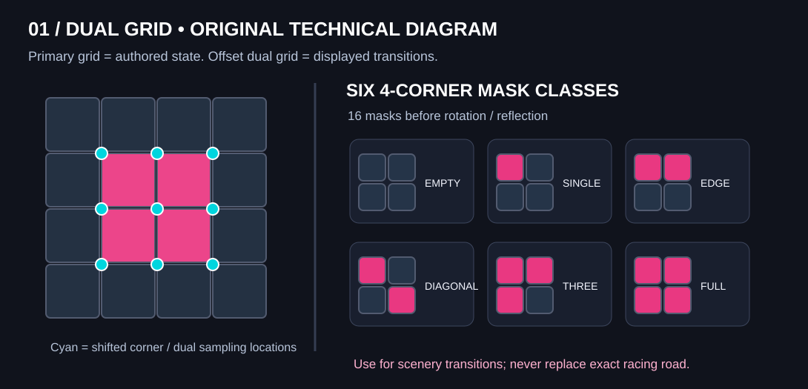
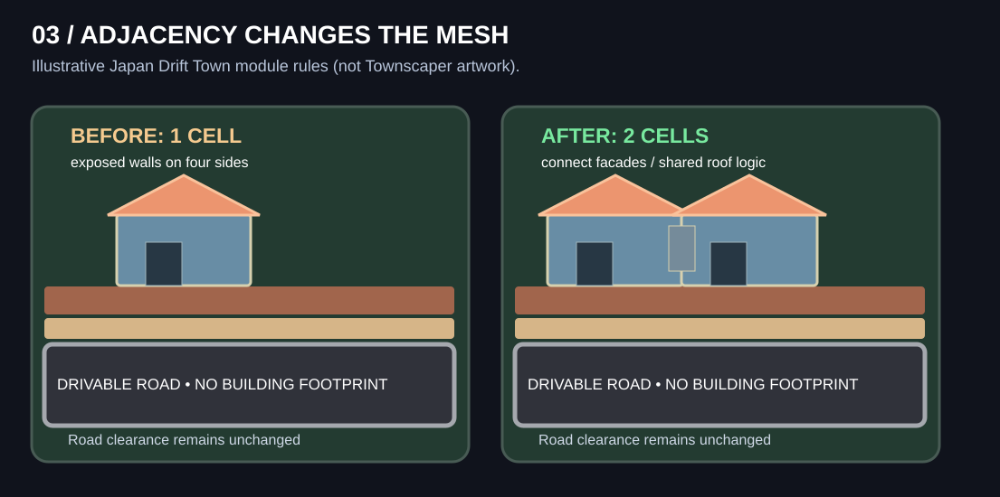
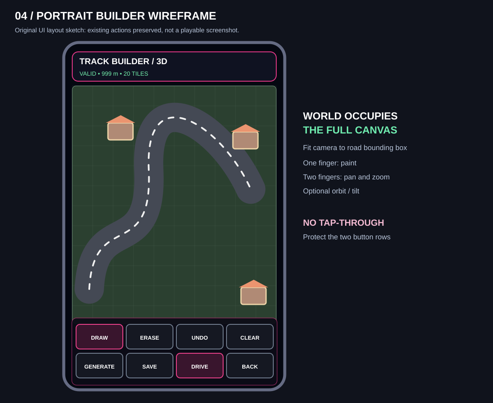

# Nitro Wheelz — Procedural World Reference Bible
**Research and implementation brief | 2026-11-19 | documentation only**

> **Read before altering Track Builder.** This document translates the ideas explained in Game Dev Buddies' [How One Guy FIXED Procedural Generation](https://www.youtube.com/watch?v=Y19Mw5YsgjI) (2026-01-08) into a **Nitro Wheelz-specific** Godot plan. It is not copied source code and it does not claim to reproduce Townscaper. The author of the techniques discussed is **Oskar Stålberg** (Townscaper / Bad North). Video chapter boundaries are verified against the video description. We could not directly download/check pixel-accurate YouTube stills in this review; use the timestamp links to inspect original frames. The SVG images below are **new explanatory diagrams, not screenshots**.


> **NEW: 20 actual frames extracted from the owner's four uploaded video recordings are now stored in the repo:** [Annotated video-frame index (with original images)](video_frames/README.md). These are distinct from the four original SVG diagrams below. Frame times refer to the uploaded clips, not the full YouTube timeline.

## 0. Critical guardrails — do not break the driving game

1. **Track DNA remains authoritative** for the exact road centreline, width, curb/barrier positions, wall collision and race progress. Never replace the spline/geometry of the driving surface with scenery tiles. Track preview and gameplay must use identical sampled road geometry.
2. Procedural generation applies to **terrain, pavements, retaining walls, architecture, vegetation and props OUTSIDE the protected road corridor**. Reject any object encroaching on asphalt, kerbs, barriers or car clearance.
3. Keep existing **DRAW, ERASE, UNDO, CLEAR, GENERATE, SAVE, DRIVE, BACK** actions (same semantics). UI may move, not disappear.
4. Editing should be fun: one-finger road paint, two-finger pan/pinch, fit-to-occupied-track bounds, optional rotate/tilt. Do not make editing require a complex mode menu.
5. Save **track data + scenery theme/version + deterministic seed + optional player overrides**. Identical save must produce identical world in editor AND race.
6. This iteration is a **one-theme prototype** (Japan Drift Town). Other themes below are later milestones; do not attempt a full WFC/city/elevation overhaul in the first PR.
7. Keep physics, HUD, sounds, car profiles and scoring untouched unless separate task requests changes.

## 1. Video index — jump to the concept and inspect the examples

Original: [How One Guy FIXED Procedural Generation — Game Dev Buddies](https://www.youtube.com/watch?v=Y19Mw5YsgjI), ~12:08. Timestamp anchors below are **official chapter starts**, not an assertion that a particular frame was captured at that exact second.

| Chapter | Open original video | What to observe | Translate into Nitro Wheelz |
|---|---|---|---|
| Intro (00:00) | [00:00](https://www.youtube.com/watch?v=Y19Mw5YsgjI&t=0s) | Why unconstrained procedural output looks repetitive | Artistic rules and recognizable handcrafted modules |
| Oskar (00:42) | [00:42](https://www.youtube.com/watch?v=Y19Mw5YsgjI&t=42s) | Player-guided building, Townscaper/Bad North inspiration | Direct manipulation and instant visual feedback |
| Regular Grid (01:49) | [01:49](https://www.youtube.com/watch?v=Y19Mw5YsgjI&t=109s) | Cells, neighbor-dependent pieces, tile variations | Existing builder grid is suitable for stage 1 |
| First Issue (03:08) | [03:08](https://www.youtube.com/watch?v=Y19Mw5YsgjI&t=188s) | Inner/outer corner mismatch and repetitive corners | Test convex AND concave edges of verge/terrain |
| Dual Grid (04:02) | [04:02](https://www.youtube.com/watch?v=Y19Mw5YsgjI&t=242s) | Offset grid, corner-state based module choice | Scenery/ground boundaries only, not driving geometry |
| New Pieces (06:17) | [06:17](https://www.youtube.com/watch?v=Y19Mw5YsgjI&t=377s) | Detailed handmade pieces and variation | Garage / warehouse / fence / house prefab families |
| Grid Deformation (07:05) | [07:05](https://www.youtube.com/watch?v=Y19Mw5YsgjI&t=425s) | Shape distortion hides the rectangular grid | Deform non-road quad props with seam-safe vertex mapping |
| Stålberg Grid (08:06) | [08:06](https://www.youtube.com/watch?v=Y19Mw5YsgjI&t=486s) | Organic quad lattice: triangle → quad → subdivide → relax | Future scenery-only irregular neighbourhoods, not MVP |
| Demo (09:55) | [09:55](https://www.youtube.com/watch?v=Y19Mw5YsgjI&t=595s) | Compare sparse vs coherent generated environment | Required before/after screenshot for one Japan scene |
| Chunks (10:31) | [10:31](https://www.youtube.com/watch?v=Y19Mw5YsgjI&t=631s) | Multi-cell pieces and neighbour-dependent larger forms | 2×1 garage, 2×2 workshops, rows, courtyards, bridges |

**Viewing task for Claude:** open the video at each timestamp, note which visible example actually demonstrates the principle, and append the final annotated time/frame if necessary. Do not claim a frame is a direct source capture unless it was captured. Do not commit third-party stills into this public repository without permission; diagrams are owned/original alternatives.

### Other verification/reference sources

- Oskar Stålberg, [SGC21 — Beyond Townscapers](https://www.youtube.com/watch?v=Uxeo9c-PX-w) (creator's talk).
- [Stålberg's explanation of the dual grid](https://threadreaderapp.com/thread/1448248658865049605.html).
- [Jess Codes — Dual-Grid System in Godot](https://www.youtube.com/watch?v=jEWFSv3ivTg) (Godot-relevant demonstration).
- [How Townscaper Works](https://www.gamedeveloper.com/game-platforms/how-townscaper-works-a-story-four-games-in-the-making) (reported development history).
- [Game Dev Buddies video overview](https://youtubesummary.com/summary/Y19Mw5YsgjI) (secondary summary; use only as supportive interpretation).

## 2. What the technical ideas REALLY mean



**Regular tile grid:** represent a cell's neighbouring occupancy; naïve 8-neighbour binary masks have `2^8 = 256` bit patterns. Rotational/mirror symmetry reduces artwork needs, but naïve corner construction can still yield mismatched concave/convex edges.

**Dual grid:** offset the placement/sampling lattice by half a square. A display module is chosen from the **four binary states at its corners**, thus `2^4 = 16` masks before symmetries. Under dihedral square symmetry these 16 cases collapse into six equivalence classes (empty, single corner, adjacent pair, diagonal pair, triple, full), with rotation/flip variants. This is a *scenery boundary/transition* technique, not a reason to change Nitro's authoritative road spline. For 3D buildings, vertical layers and sockets create additional states: do NOT assume six meshes suffice for all architecture.

**Handcrafted modules + rules:** the algorithm should **select and connect attractive designed pieces**, not generate featureless random boxes. Pieces expose compatible sockets on N/E/S/W and optional vertical connections (foundation, wall, roof, arch, terrace). External walls only on exposed faces; when a neighbour is added, the internal wall disappears and roofs/trim re-resolve.

**Variation:** add deterministic colour/roof/window/prop variants for equivalent masks. Seed with `hash(world_seed, cell_x, cell_y, layer, role)` so editing one tile does not reshuffle the whole village.

**Irregular grid:** Stålberg's larger idea is an **organic quad lattice** generated from triangle/quad transformations and relaxation. Deform *hand-authored tile-local vertices* into each destination quad (e.g., bilinear mapping). Shared seam vertices must map to exactly equal world positions. This is phase 3, only after a good regular-grid module library exists. Do not deform drivable road edges or their collider.

**Chunks / multi-cell motifs:** check groups before single cells. When an allowed 2×1 or 2×2 footprint matches, place a special coherent structure (garage block, row of shops, workshop courtyard, parking lot, footbridge), then lock its footprint and suppress redundant generic pieces.

**WFC:** Wave Function Collapse or model synthesis is an *optional later constraint-solver*, not mandatory for a few deterministic adjacency rules. A small rule table plus local repair will be easier to test on mobile.

## 3. Three original explanatory figures

- [01 — Dual grid and six corner-mask classes](./01_dual_grid_explained.svg)
- [02 — Track DNA → protected road → procedural scenery → identical editor/race world](./02_track_world_pipeline.svg)
- [03 — Road edge adjacency and evolving building cluster](./03_adjacency_demo.svg)
- [04 — Portrait builder layout preserving all eight buttons](./04_mobile_builder_layout.svg)

These **are not frames from the YouTube video**; they are engineering diagrams drawn for Nitro Wheelz. Each chapter above links to the exact original footage section, which is the authoritative visual reference.

## 4. Nitro Wheelz world architecture


```text
Track DNA (road nodes, widths, validation)  <-- unchanged
   |
   v
Sampled centreline + exact road / kerb / wall edges
   |
   +---> driving road mesh + analytic/mesh collision  <-- unchanged
   |
   v
Protected road corridor (distance-to-edge + wall/prop clearance)
   |
   v
Scenery field + reusable grid cells / themes
   |
   +---> terrain transitions (dual-grid / edge masks)
   +---> deterministic placement with adjacency sockets
   +---> handcrafted building families / optional 2x2 motifs
   +---> props, landscaping, lighting, background
   |
   v
One serialized world descriptor --> same generator in Editor + Race
```

Suggested separations (illustrative, inspect repository first):
- `game/scripts/world/procedural_world.gd` — deterministic generator / scene coordinator.
- `game/scripts/world/scenery_rules.gd` — masks, sockets, clearance and themes.
- `game/scripts/world/scenery_modules.gd` — original stylised meshes or prefab catalog.
- `game/assets/themes/japan_drift_town.json` — modular weights, palette and seed params.
- `game/tests/procedural_world_test.gd` — fail-closed regression tests.
- Existing `game/scripts/world/track_dna.gd`, `drift_track.gd` and `track_grid.gd` stay authoritative for roads.
- Existing `game/scripts/ui/track_builder.gd` handles touch/UI; do not embed all terrain generation and decoration rules in this already-large script.

### Protected road buffer

Use actual sampled road **edges**, not only a track centreline approximation. Exclusion envelope = rendered asphalt/kerb/barrier outer boundary + tunable scenery clearance. Test every candidate module footprint (not only its centre) against the continuous road corridor; never allow a visual building, roof, trunk or fence to block the racing line, camera or collision. Barriers/kerbs remain exactly road-authored.

### Minimal neighbour rule example

```gdscript
# Illustrative pseudocode; review actual data types and coordinates first.
func can_place_module(cell: Vector2i, module: Dictionary, world: Dictionary) -> bool:
    if footprint_intersects_road_clearance(cell, module["footprint"], world):
        return false
    for side in ["N", "E", "S", "W"]:
        var adjacent = lookup_neighbour(cell, side, world)
        if not compatible_socket(module["sockets"][side], adjacent):
            return false
    return true

func on_cell_changed(cell: Vector2i) -> void:
    var region = touched_cells_plus_one_ring(cell)
    recompute_masks_and_modules(region)
    rebuild_dirty_chunks(region)
    # No full-world re-roll; keep deterministic per-cell seeds.
```



### Modules for first playable vertical slice: JAPAN DRIFT TOWN

| Family | 1-cell versions | Multi-cell or neighbour variants | Where placed |
|---|---|---|---|
| Garage | stand-alone box, shutter, workshop | 2×1 combined workshop + service bays | near access roads, not on track |
| Industrial | utility hut, transformer, container | 2×2 warehouse with joined roof | outside turns, beyond safety zone |
| Streetscape | path, paving, drainage, verge | connected sidewalk / retaining edge | on non-driving shoulders |
| Architecture | small Japanese-style house/shop | rowhouses, corner shop, shared roof | secondary areas |
| Boundary | posts, fence, trees, shrubs | continuous fence line, clipped corners | non-track boundary |
| Props | lamps, signs, vending machines, cones | parking/courtyard composition | at readable scales, outside collision |

Visual tone: **stylised die-cast/drift-diorama 3D**, recognisable forms, constrained palette, subtle texture, deliberate silhouette; do not replicate Townscaper's Mediterranean houses or paste screenshots as in-game textures. Asphalt/blue-white kerbs and car remain the hero. Keep racing visibility from the approved camera, especially on a mobile portrait screen.

## 5. Builder mobile screen



Current verified repo implementation (v0.1.22 branch checked 2026-11-19):
- `game/scripts/ui/track_builder.gd`: `grid = GRID.new(8,12)`; road paint via camera ray to grid; tile links, draft, undo, Generate, Save, Drive.
- UI header occupies about 8.8% of screen height; tool rows begin around 81.5% and 90.3% of height; map input rect about 70% high; fixed camera tilt `TILT_DEG = 68`.
- Camera `_fit_camera()` uses `grid.size_metres()` for *the entire grid*, not the occupied road bounding box; this causes wasted grass space around a small circuit.
- Main menu Track Builder offers 3D Tiles, Edit Nodes and Generate & Drive. Do not collapse those distinct modes unintentionally.

Proposed layout rules:
1. Compact single-line HUD (name + loop status + small optional FIT/CAMERA).
2. Full-bleed 3D rendering behind transparent controls, but **input mask** protects controls.
3. Two bottom rows of 4 tactile buttons in current order. Respect Android system insets/gesture navigation.
4. Fit camera to **occupied road bounds + scenery margin**. Smoothly adjust on updates; do not lurch on each tile placement.
5. One-finger DRAW/ERASE, two-finger pinch/pan; optional two-finger rotate/tilt behind toggle. Gesture pointer ownership must not paint roads accidentally.
6. World in editor must match race world after SAVE/DRIVE; no scenery-only preview that disappears in play.

## 6. Future biome / scene theme cards (data-driven, **do not implement all now**)

| Theme | Signature objects / colours | Distinctive procedural constraints |
|---|---|---|
| **Japan Drift Town** (first) | slate asphalt, neon-pink accents, cherry trees, compact garages, warehouses, ramen shop/storefronts | readable dark driving surface, night lighting, lanes and buildings at safe distance |
| **Polska Jesień** | amber/red maples, birch, wet grey roads, country buildings, fields, mist, Polish roadside fences | fallen leaves/surface decals outside car footprint; village clusters rather than generic forest |
| **Piaski / Sunny Baltic Coast** | beach dunes, pine trees, warm sand, small coastal shops, wooden boardwalks, sea reflections | controlled waterline, no abrupt road-to-water transitions |
| **Industrial Drift Yard** | steel sheds, smoke stacks, containers, cranes, painted concrete, floodlights | grouped 2x2 factories, loading bays and clear runoff |
| **Stadium Drift Event** | bowl-like grandstands, paddock, lighting towers, crowd colours, barriers | fictional stadium-inspired environment; no copied National Stadium logos/geometry/branding |
| **Mountain Touge** (later tech milestone) | forests, switchbacks, rock retaining walls, lookout areas, distant valley | **requires height-aware roads, grade, collisions and cameras**; not compatible with a naive flat-track scenery-only hack |

Theme data should alter modules, probabilities, palette, terrain, lighting and props without duplicating Track DNA or physics.

## 7. Phased delivery (do NOT attempt a rewrite)

**Phase A — demonstrable 3D vertical slice** (only one compact section of one track):
- fit camera to actual occupied bounds; preserve all eight buttons, touch drawing and saving.
- spawn three hand-authored module types: standalone garage, joined 2×1 workshops, matching fence/verge.
- neighbour placement instantly converts one standalone unit into joined units, with no overlaps.
- one deterministic seed; removing a cell restores valid exposed exterior wall and roof.
- the same scenery appears when DRIVE is pressed; prove with 2 screenshots (builder and race).

**Phase B — polish + mobile scaling**:
- add a 2×2 yard/workshop composition; props and tree clustering, anti-repetition variants; clean corner masks and seam checks.
- incremental dirty cell/chunk rebuild, pooled/instanced meshes, camera fade/occlusion for objects blocking the car; mobile performance tests.

**Phase C — optional organic irregular quad scenery**:
- deformation with shared vertex edges, test convex/concave modules; no alteration to Track DNA collider. Explore more complex chunks and themes.

## 8. Definition of Done (testable, no vague "looks great")

1. A 1-cell garage + neighbouring cell triggers a visible **connected 2-cell building** without roof overlap or internal wall. Removing a cell restores exterior facade; undo returns previous version.
2. Adding a tile only recomputes local affected cells/chunks (no whole-map reshuffle); same seed yields identical mesh/placement IDs after reload and in Web/Android where supported.
3. No scenery overlaps buffered track/kerbs/walls, no road bends or widths changed, physics/score golden traces unchanged.
4. Two images show the **same road and scenery** in builder and in race; record the world seed and build commit.
5. Portrait screen uses occupied area better than baseline, all eight buttons operable, gesture navigation works with two fingers, no tap-through.
6. Initial one-theme vertical slice measured on Android and Web; report FPS, frame spikes, scene load time, memory and device. Headless tests alone are not device QA.
7. Track editor and built-in race modes remain compatible; save/load preserves the original road path.

## 9. Handoff message for Claude

**Read this entire file and inspect the four SVG figures before changing code.** Then inspect `game/scripts/ui/track_builder.gd`, `game/scripts/world/track_grid.gd`, `game/scripts/world/track_dna.gd`, `game/scripts/world/drift_track.gd` and current tests. Produce a small architecture plan and implement **Phase A ONLY**. Start with original, recognizable handmade modules that visibly connect by adjacency. Preserve driving road DNA, all 8 builder controls and Android/Web. Produce side-by-side builder/race screenshots and tests. Explain any deviation, do not falsely claim pixel frames were captured from the video.
