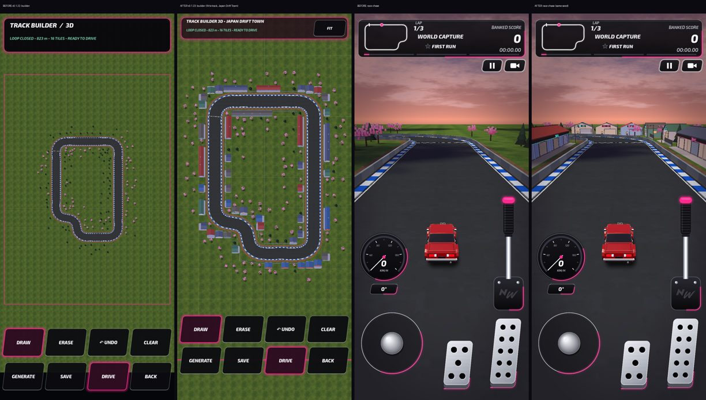
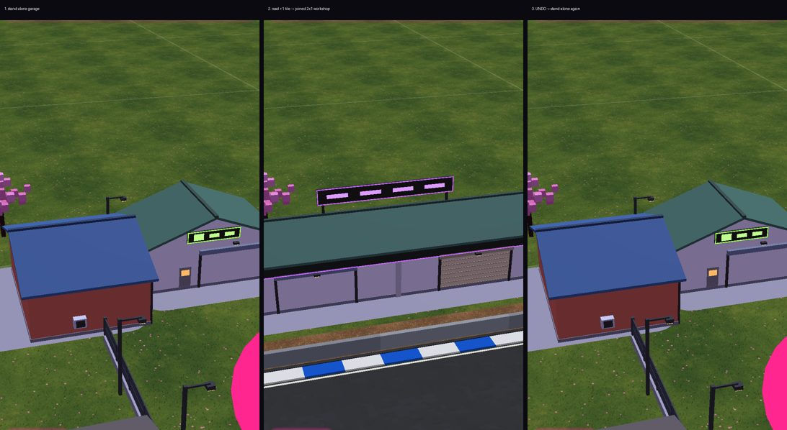
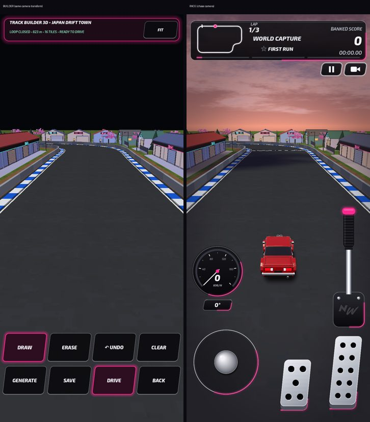
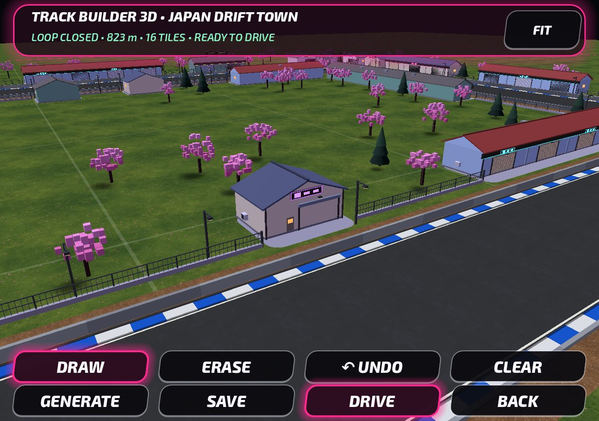

# Procedural world — Phase A report (Japan Drift Town vertical slice, v0.1.23)

Scope: **Phase A only** of the [Procedural World Bible](NITRO_PROCEDURAL_WORLD_BIBLE.md). Full town, Phase B polish and other themes are **not** started — waiting for the owner's visual review.

## What was built (architecture)

```text
builder road tiles (links)  ──►  NitroSceneryRules  ──►  plan per 14 m scenery cell  ──►  module keys
        │  (same tiles are saved in the track's "builder" block + "world": {theme, seed, version})
        ▼
Track DNA control points (unchanged)                 NitroSceneryModules (hand-authored pieces)
        │                                                     │
        ▼                                                     ▼
race road / walls / physics (unchanged)        NitroProceduralWorld: chunks of 2x2 road tiles,
                                               rebuilt only where a module key changed
```

| File | Role |
|---|---|
| `game/scripts/world/scenery_rules.gd` | Analytic road field from the tiles (straight through the tile centre / quarter arc radius 28 m in corner tiles = the shape Track DNA follows), clearance, 4×4 scenery cells per tile, facing (N/E/S/W toward the road), lots, fences, greenery, rows, **module keys**, deterministic integer hash (same on Android/Web). |
| `game/scripts/world/scenery_modules.gd` | Original hand-modelled pieces: stand-alone garage (front gable, roller shutter with ribs, side door, gable neon sign, wall lamp, downpipes, AC unit), workshop row cell (left end / middle / right end, continuous roof along the street, gable walls only on exposed ends, shared pilaster, continuous fascia + neon line, one long roof sign on a 2-cell workshop), block-and-mesh fence (shared posts, end posts), concrete apron with dual-grid-style corner masks (rounded where no paved neighbour, straight where the slab continues), street lamp; tree art shared with the race. |
| `game/scripts/world/procedural_world.gd` | Coordinator used by **both** the builder and the race: full build, incremental `update()` (re-plan changed tiles ± 1, recompute keys there and along affected rows, rebuild only chunks with changed keys), `placements()` for tests, mesh statistics. |
| `game/scripts/world/drift_track.gd` | Race: a saved track with `world` + `builder` blocks rebuilds the same world (its own roadside trees/flowers are switched off); the tiles must reproduce the saved control points exactly, otherwise (e.g. reshaped in the node editor) no tile world is built. |
| `game/scripts/ui/track_builder.gd` | World under the road preview; compact floating bar + **FIT**; camera frames the **occupied** track; pinch zoom + two-finger pan (a second finger withdraws the first finger's half-painted tile); the same eight buttons in the same order in two bottom rows; world seed saved in the draft and in the track. |

Rules in one paragraph: a 14 m cell is a **lot** when a building fits with its front ≥ 7.5 m from the road edge, the road edge is ≤ 21 m in front of it, and no frontage cell stands in front of it; a per-cell hash of the seed makes ~66 % of lots buildings and the rest fenced yards. Buildings side by side with the same facing, setback and depth **join** into one row; a row of 1 is a stand-alone garage, 2 a 2×1 workshop with one long roof sign, more a longer workshop row. Fences join into runs. Trees only within 46 m of the road. Everything keeps ≥ 5.6–7.5 m from the road edge (verge is 3.6 m).

## Evidence

| | |
|---|---|
|  | **BEFORE / AFTER** — same 16-tile loop. Builder: oversized header and whole-grid camera → compact bar, camera fitted to the track, Japan Drift Town around the road. Race chase view: trees → the same town. |
|  | **Adjacency** — a stand-alone garage; DRAW one more tile: the neighbouring lot now faces the same road and the two cells become one 2×1 workshop (one roof, no inner wall, one roof sign); UNDO: the stand-alone garage with its exterior walls is back. |
|  | **Builder vs race** — the race chase camera transform copied into the builder: same buildings, rows, signs and trees (world seed 2106). |
|  | 3/4 close-up: stand-alone garage, joined workshop rows, fence runs ending at the garage, lamps, rounded aprons. |

Capture tool: `game/tests/capture_world.gd` (Xvfb + Mesa llvmpipe, not a phone).

## Tests (all PASS locally, Godot 4.7.2 headless)

- `procedural_world_test.gd` — join/split on road growth/shrink, builder UNDO, determinism, builder world == race world (from the saved JSON), different seed ≠ same world, **no building / fence / tree within its setback of the compiled race road on 12 generated circuits** (1249 buildings, 711 fences, 1738 trees checked), no building overlaps, incremental rebuild keeps untouched chunk nodes, Track DNA control points unchanged by the world block, reshaped road keeps no tile world, race builds the identical world.
- `track_builder_test.gd` — plus: world theme/seed saved, all eight buttons in two bottom rows, compact bar, FIT, fit-to-occupied-track, pinch zoom without painting.
- Whole suite (24 tests) PASS; physics golden trace unchanged (`car_profiles_test`).

## Measurements (cloud container CPU, not a phone)

| | |
|---|---|
| Full world build, 24-tile loop | ~225 ms (plan ~150 ms + meshes ~80 ms) |
| One-tile edit (incremental) | ~76 ms: 240 cells re-planned, 4 of 14 chunks rebuilt |
| Geometry, 24-tile loop | 14 chunks, 77.7 k vertices / 38.9 k triangles, 53 multimeshes, 3.7 k tree voxel instances |
| Draw calls | ≤ 2 mesh surfaces + ≤ 4 multimeshes per chunk; chunks are frustum-culled in the race |

**NOT RUN:** FPS, frame spikes, load time and memory on an Android phone and in a browser (needs the device / the CI build in a real browser). Expect roughly 3–4× the container times on a mid-range phone (≈ 0.8 s world build when the race / builder opens, ≈ 0.25 s after lifting the finger from an edit).

## Known limits (Phase B material)

- The world updates when the finger lifts (and on tap), not during a drag stroke.
- Long straights produce long workshop rows with repeated bays; corners produce more stand-alone garages. Variety (2×2 yards, props, tree clusters, anti-repetition), Japanese houses/shopfronts, parking, harbour/water: Phase B.
- Theme data lives in code constants (`THEME`, palettes, densities); the saved `world.theme` key is the hook for data-driven themes later.
- Top-down race camera shows ~35 m across, so the town is seen mostly in corners and from the chase camera.
- No device QA yet.
