# Procedural World — Extracted Video Frames (Nitro Wheelz)

**Source:** four screen-recorded video clips supplied by the project owner: `1000076078.mp4`, `1000076079.mp4`, `1000076080.mp4` and `1000076081.mp4`. They reproduce portions of [Game Dev Buddies — How One Guy FIXED Procedural Generation](https://www.youtube.com/watch?v=Y19Mw5YsgjI). **These are actual stills extracted from the uploaded video files**, not generated diagrams or live YouTube screenshots. Times are measured **within each uploaded clip**, not from the beginning of YouTube. Frames are downscaled solely as review references; do not re-use as in-game textures, copied buildings or promotional assets. Source material remains the creator's.

**Read alongside:** [Nitro Procedural World Bible](../NITRO_PROCEDURAL_WORLD_BIBLE.md) and [original diagrams](../01_dual_grid_explained.svg).

## What Claude must extract from the evidence

1. **Phase A (now):** take the reliable *four-corner dual-grid masks*, a small set of handmade garage/workshop modules, neighbour sockets and special 2×1 chunks. The connected before/after must be visible in editor and race.
2. **Phase B:** add local procedural variation, edge/terrain transitions, roof/fence continuity, deterministic seeding and performance-aware updates.
3. **Phase C (later):** only after the basics are playable, experiment with irregular dual grids, geometry deformation, triangle-to-quad, relaxation and WFC-like constraints. Roads, barriers and collisions **remain defined by Nitro Track DNA**.
4. Never turn the racing circuit itself into a low-resolution tile mesh. Build *scenery around* the exact validated spline, with a clear safety exclusion zone.

## Clip 1000076078 — base grid, dual grid, corner masks

### 1. Square-cell base grid — `1000076078` at 00:05

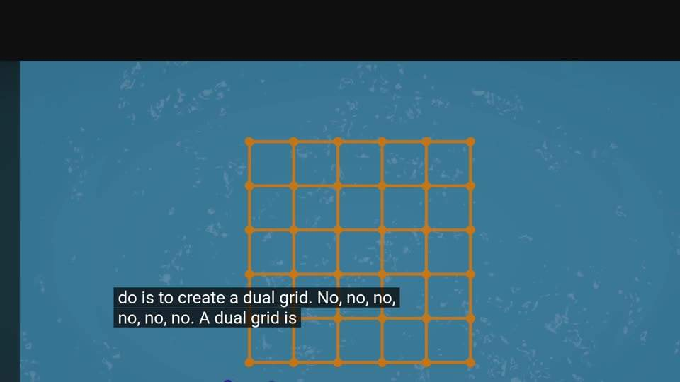

**What the frame demonstrates:** Square-cell base grid. **Nitro implementation:** Shows the starting lattice. Keep Nitro’s road tiles and Track DNA; create a parallel scenery field.

### 2. Offset dual grid — `1000076078` at 00:12

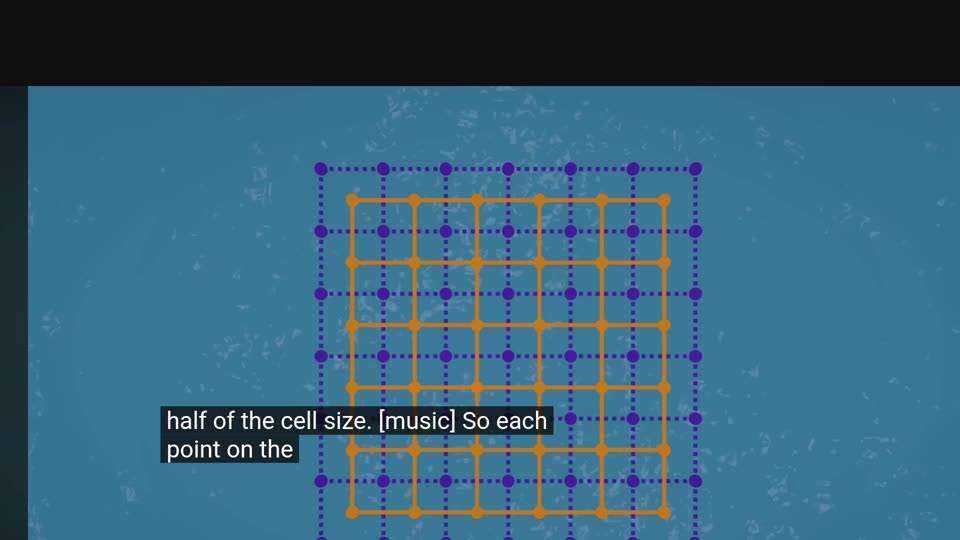

**What the frame demonstrates:** Offset dual grid. **Nitro implementation:** Sample four neighbouring occupancy states around each dual cell.

### 3. Tile formed from four corner states — `1000076078` at 00:42

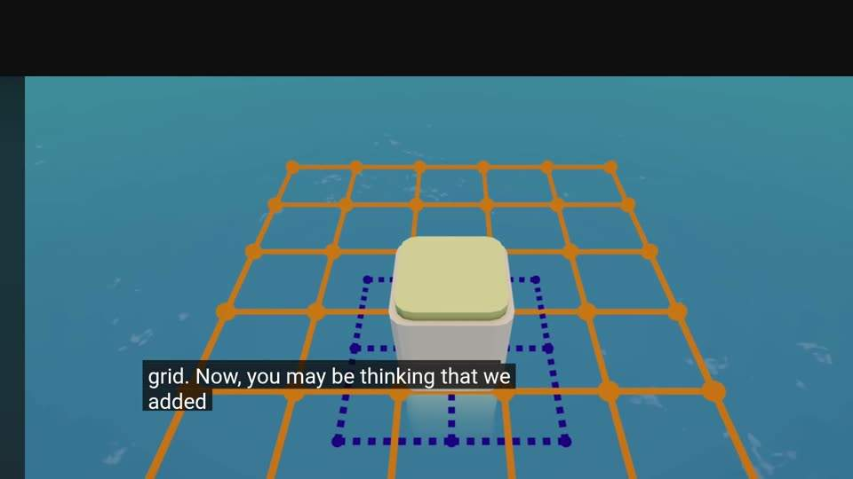

**What the frame demonstrates:** Tile formed from four corner states. **Nitro implementation:** Select a terrain/verge transition module from its local corner mask.

### 4. 16 corner-state combinations — `1000076078` at 01:23

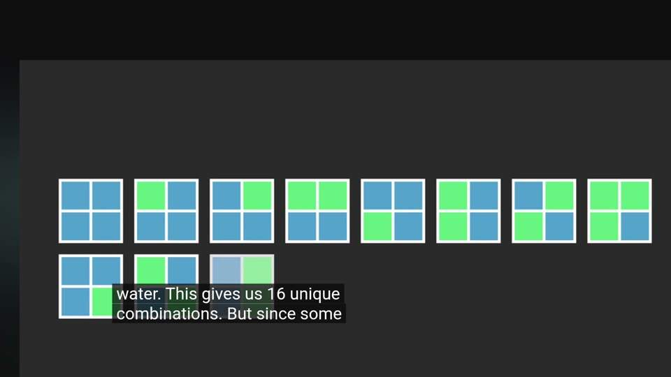

**What the frame demonstrates:** 16 corner-state combinations. **Nitro implementation:** Four binary corners yield 16 masks before symmetry; author variants for convex, concave and diagonal states.

### 5. Convex and concave rounded corners — `1000076078` at 02:01

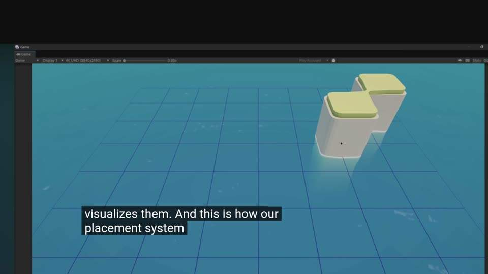

**What the frame demonstrates:** Convex and concave rounded corners. **Nitro implementation:** Check joins and exposed edges; avoid visible square seams and bad corner bends.

### 6. Combined geometry — `1000076078` at 02:12

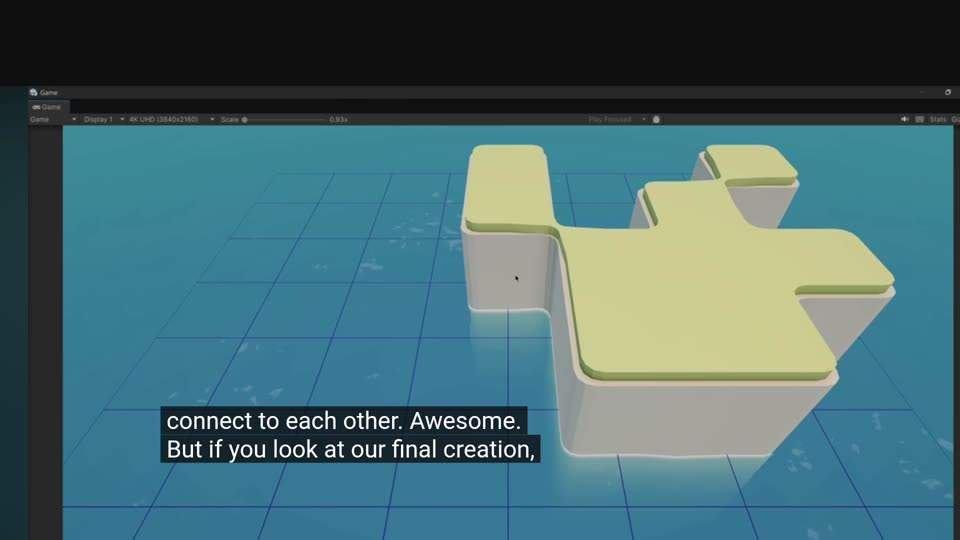

**What the frame demonstrates:** Combined geometry. **Nitro implementation:** Neighbouring cells should read as one designed landform, not isolated blocks.

## Clip 1000076079 — variations and mesh deformation

### 7. Hand-authored variations — `1000076079` at 00:03

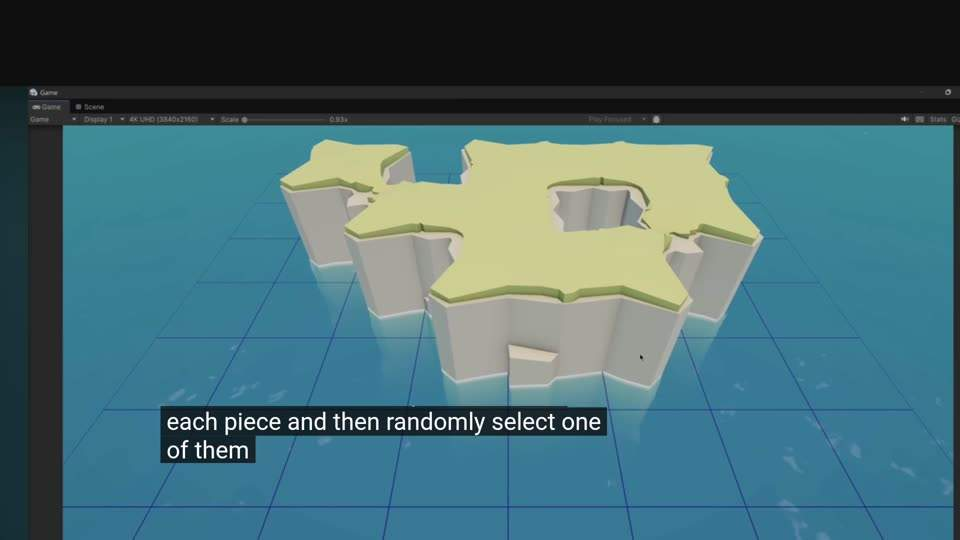

**What the frame demonstrates:** Hand-authored variations. **Nitro implementation:** Randomly choose among compatible variants with deterministic per-cell seeds.

### 8. Irregular grid preview — `1000076079` at 00:34

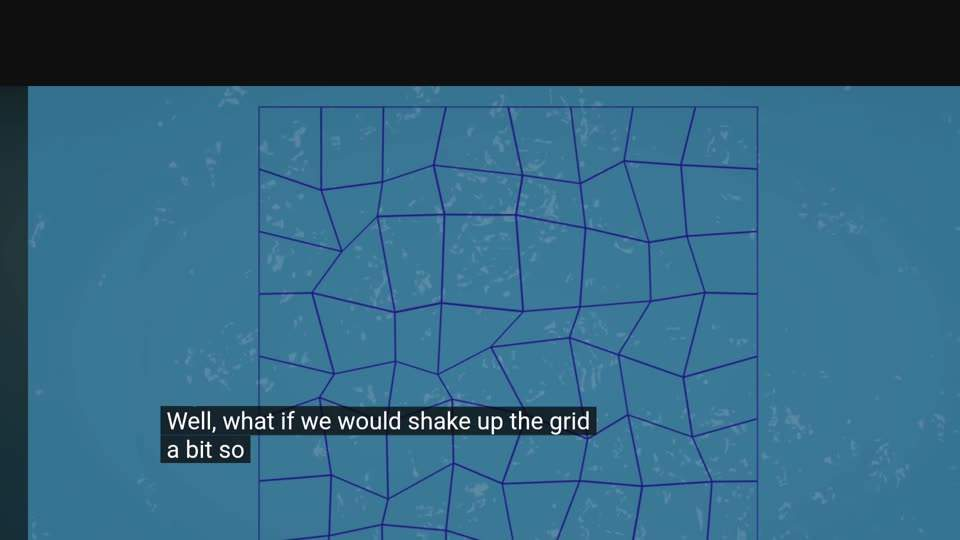

**What the frame demonstrates:** Irregular grid preview. **Nitro implementation:** Use organic grids for scenery only in a later phase, after the regular-grid system works.

### 9. Module deformation handles — `1000076079` at 00:53

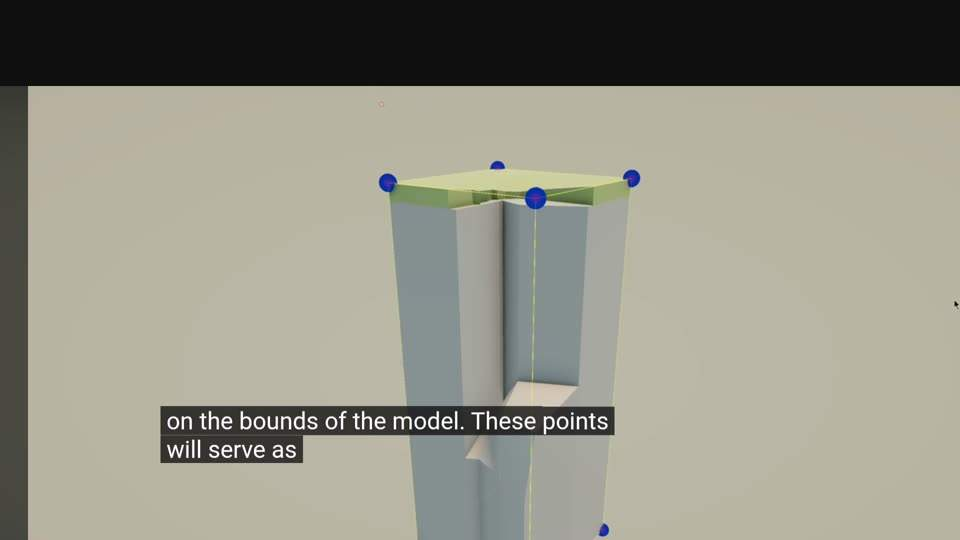

**What the frame demonstrates:** Module deformation handles. **Nitro implementation:** Define boundary control handles on a mesh and warp it to the target polygon.

### 10. Normalized deformation constraints — `1000076079` at 01:13

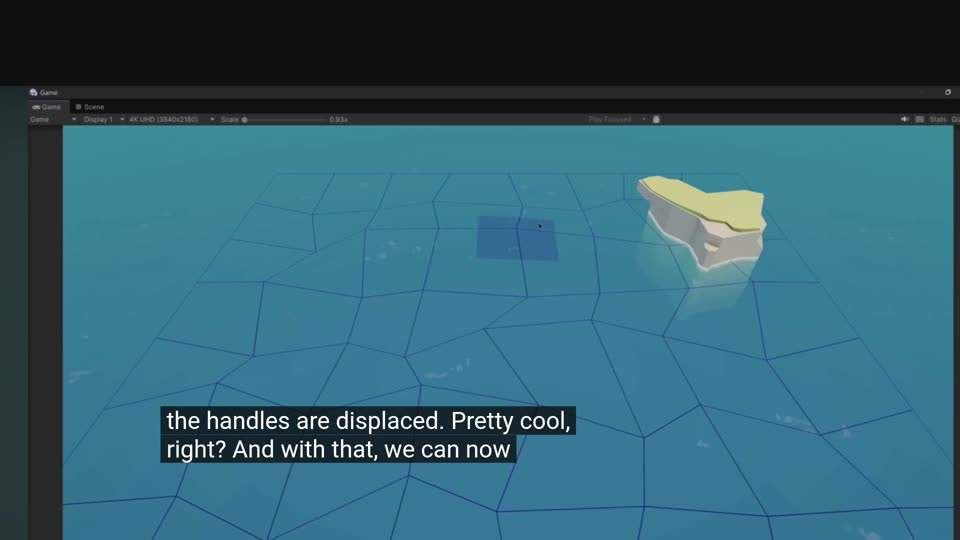

**What the frame demonstrates:** Normalized deformation constraints. **Nitro implementation:** Store relative positions and preserve matching seams when neighbouring pieces deform.

### 11. Organic islands after distortion — `1000076079` at 01:25

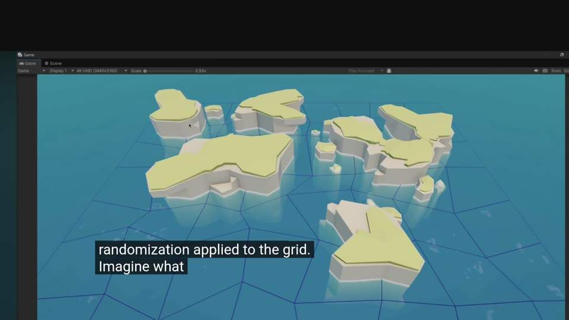

**What the frame demonstrates:** Organic islands after distortion. **Nitro implementation:** Demonstrates why irregular cells help reduce obvious repetitions.

### 12. Hexagon / triangle-to-quad construction — `1000076079` at 02:05

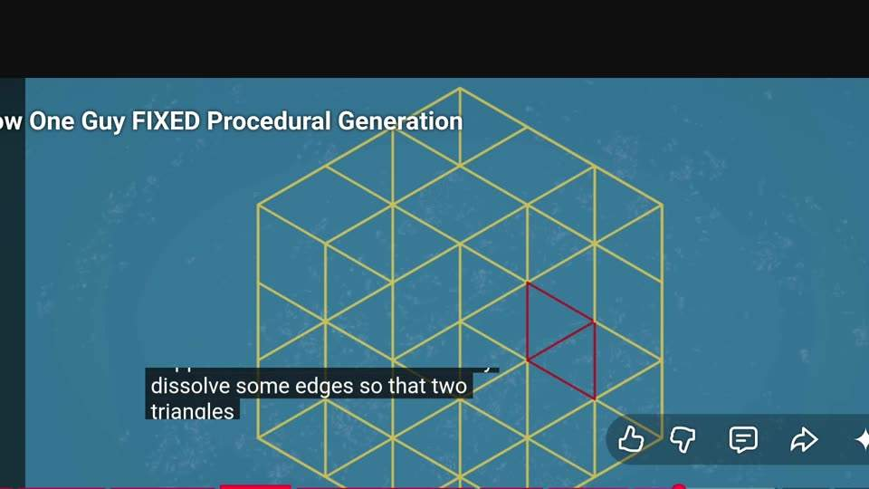

**What the frame demonstrates:** Hexagon / triangle-to-quad construction. **Nitro implementation:** Research-only for Nitro v1; defer irregular quad lattice until the basic world works.

## Clip 1000076080 — organic quads, chunks, town result

### 13. Subdivide quadrilateral faces — `1000076080` at 00:20

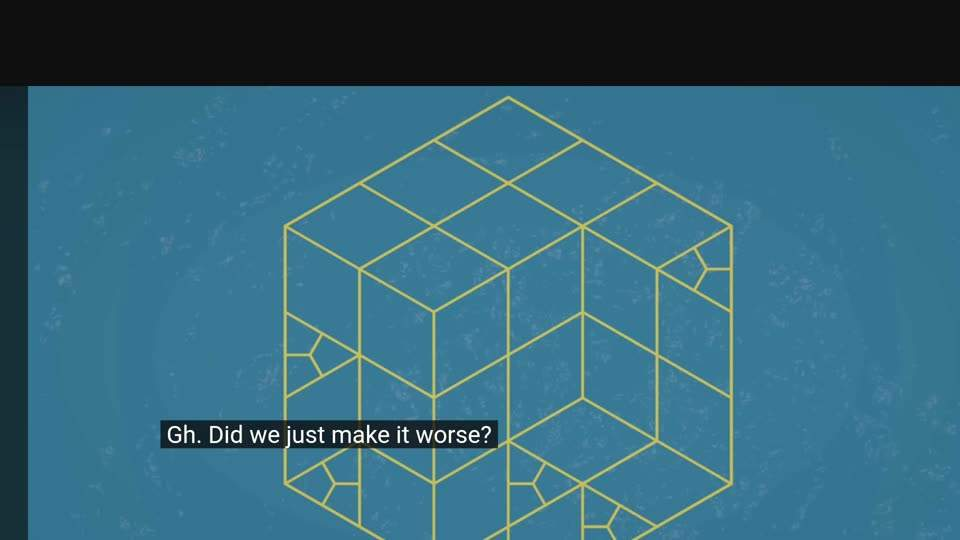

**What the frame demonstrates:** Subdivide quadrilateral faces. **Nitro implementation:** Subdivide locally where detail is needed; track CPU/GPU and vertex count on Android.

### 14. Relaxation of grid points — `1000076080` at 00:42

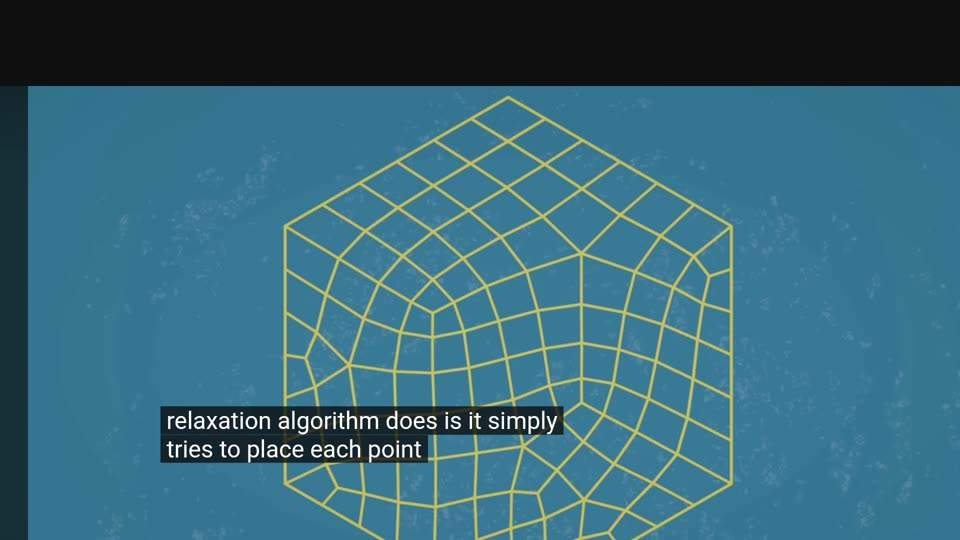

**What the frame demonstrates:** Relaxation of grid points. **Nitro implementation:** Move scenery vertices toward even spacing while keeping shared boundaries aligned.

### 15. Joined relaxed quad patches — `1000076080` at 01:04

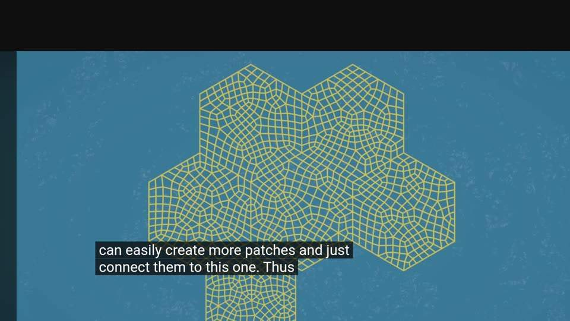

**What the frame demonstrates:** Joined relaxed quad patches. **Nitro implementation:** Future terrain/architecture tool; do not alter road collision or racing geometry.

### 16. Detailed handcrafted Blender module — `1000076080` at 01:44

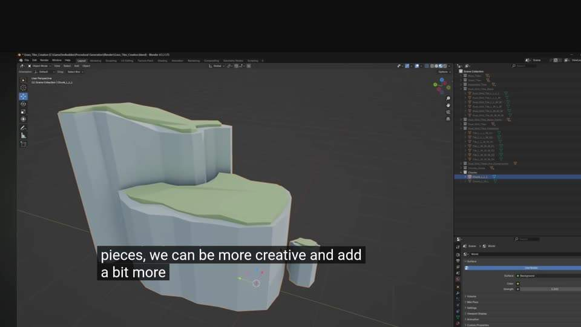

**What the frame demonstrates:** Detailed handcrafted Blender module. **Nitro implementation:** Design a small set of attractive recognisable garage/workshop modules before building a solver.

### 17. Neighbour-match larger module — `1000076080` at 02:02

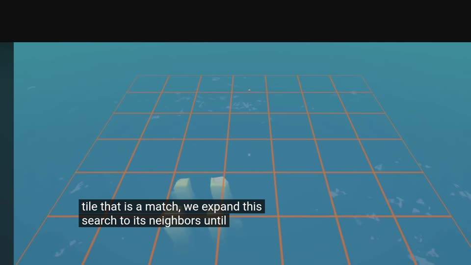

**What the frame demonstrates:** Neighbour-match larger module. **Nitro implementation:** First check larger patterns, then fall back to single-cell props. Add a 2×1 workshop module.

### 18. Connected colourful town result — `1000076080` at 02:14

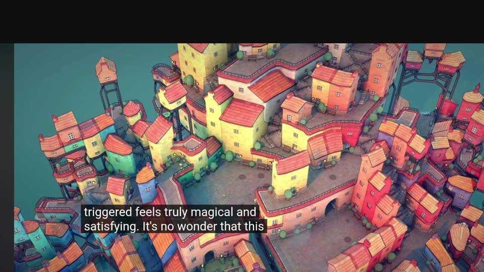

**What the frame demonstrates:** Connected colourful town result. **Nitro implementation:** Aim for cohesive, joined architecture and readable silhouette, not copying the buildings or colours.

## Clip 1000076081 — model synthesis / WFC (optional)

### 19. Example-based model synthesis reference — `1000076081` at 00:16

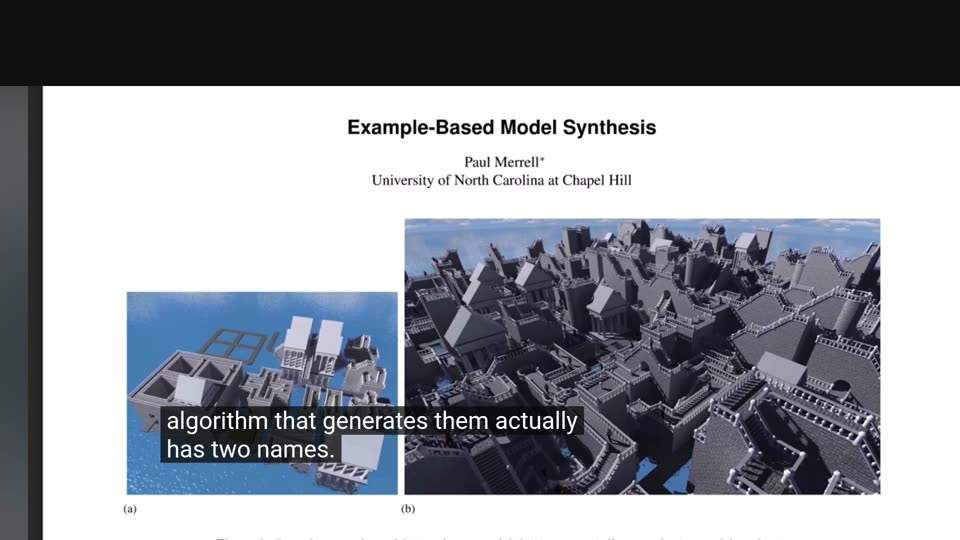

**What the frame demonstrates:** Example-based model synthesis reference. **Nitro implementation:** Advanced constraint-solver example; do not make this the initial implementation.

### 20. Wave Function Collapse example — `1000076081` at 00:23

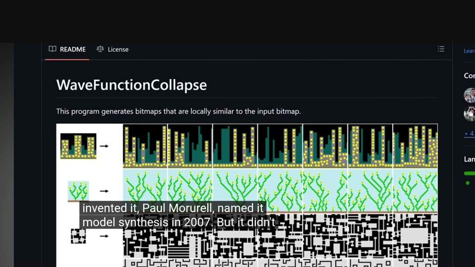

**What the frame demonstrates:** Wave Function Collapse example. **Nitro implementation:** Alternative advanced technique; basic adjacency rules are sufficient for Phase A.

## Implementation acceptance criteria

- Screenshot-proof: (a) single standalone workshop, (b) neighbouring tile causing a correctly connected two-unit workshop, (c) removing neighbour reveals an exterior wall, (d) identical scene in racing view.
- No road/kerb/wall collision mesh changes; no environment element overlaps race corridor, and player camera remains readable.
- Edited cell updates local dependent module(s), not every part of the map. Saved seed guarantees reproducibility.
- Mobile full-bleed builder retains DRAW / ERASE / UNDO / CLEAR / GENERATE / SAVE / DRIVE / BACK, with touch and safe areas verified on Android.
- Document timings, memory, FPS, build size, and baseline golden physics and camera test results. Do not claim a qualitative audio or device QA test unless actually performed.

**Copyright and scope:** Reference images from the owner's screen recording of a third-party educational video, provided only for internal research, commentary and implementation guidance. They are not licensed as game art. Keep this limited selection for documentation, credit the original video/author, and obtain permission before wider redistribution if necessary.
